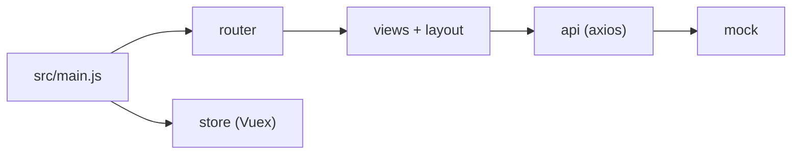

# PanJiaChen/vue-admin-template

> Minimal Vue admin interface template with Element UI, for starting a back office.

## The problem
Starting a back office requires routing, a layout, global state and an API call layer before writing a single feature.

## What it actually does
A ready-to-clone vue-cli project: Vue Router, Vuex (app, settings, user modules), Element UI, axios, a mock server for development, SVG icons, ESLint and unit tests. The README says role-based permission control is in another branch, and mentions a separate TypeScript version.

## How it is wired


## Trying it
```bash
git clone https://github.com/PanJiaChen/vue-admin-template.git
cd vue-admin-template
npm install
npm run dev
npm run build:prod
npm run lint
```

## Cost and gotchas
Free. Version 4.0 or later uses vue-cli; the old version without vue-cli is on tag 3.11.0. Last push on 2024-04-27, over a year ago. Targets Vue 2 and Element UI, not Vue 3.

## What it is not
Not a complete application: it is a skeleton with fake data. Role-based permission is not in the main branch.

## Alternatives
`vue-element-admin` (full version), `vue-typescript-admin-template` and `electron-vue-admin`, cited in the README.

## For you
Ignore: old Vue 2 template, maintained by one person, unrelated to data; useful only for a throwaway back office.
