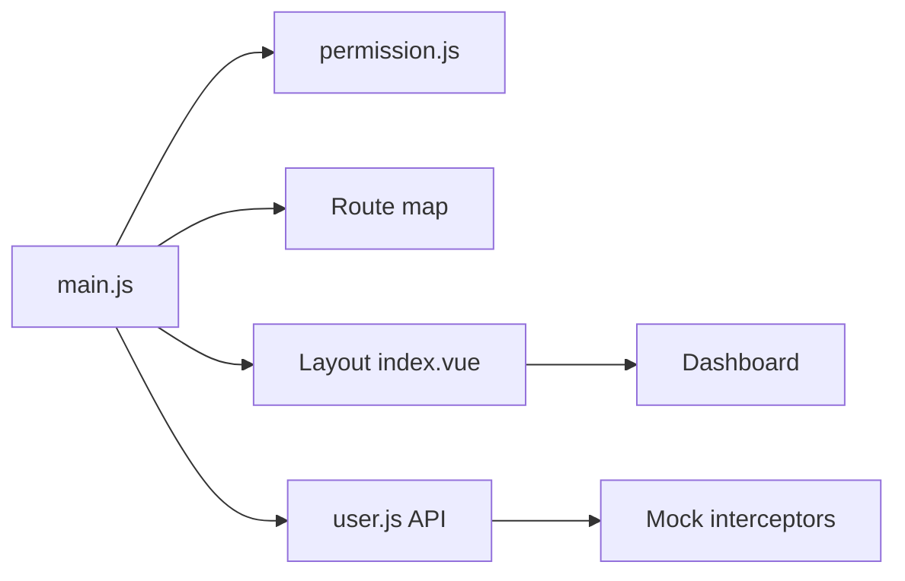

# PanJiaChen/vue-element-admin

> Vue administration interface template with Element UI, including simulated permissions and data.

## The problem
Setting up an administrative interface (login, roles, dashboards, editors) from scratch is a time-consuming process.

## What it actually does
Single-page application built with Vue, featuring routing, role-based permission management, adaptive layout, Vuex state management, tables, and editors (rich text, Markdown, JSON), Excel import/export, ECharts and i18n on a separate branch. Data is simulated using Mock.js. The README specifies that version 4.x uses vue-cli and does not support older browsers.

## How it is wired


## Trying it
```bash
git clone https://github.com/PanJiaChen/vue-element-admin.git
cd vue-element-admin
npm install
npm run dev
npm run build:prod
```
Open http://localhost:9527.

## Cost and gotchas
Free, MIT license. Last update was on 2024-10-24 (over a year ago), with 1,401 open issues. Based on Vue 2 and Element UI, according to the README.

## What it is not
Not a current database: the ecosystem has evolved. The data is simulated, not a real backend.

## Alternatives
vue-admin-template (recommended base template), electron-vue-admin, and vue-typescript-admin-template, which are referenced in the README.

## For you
To be ignored: For a model dashboard, a more recent and actively maintained tool will perform better than a static Vue 2 template.
