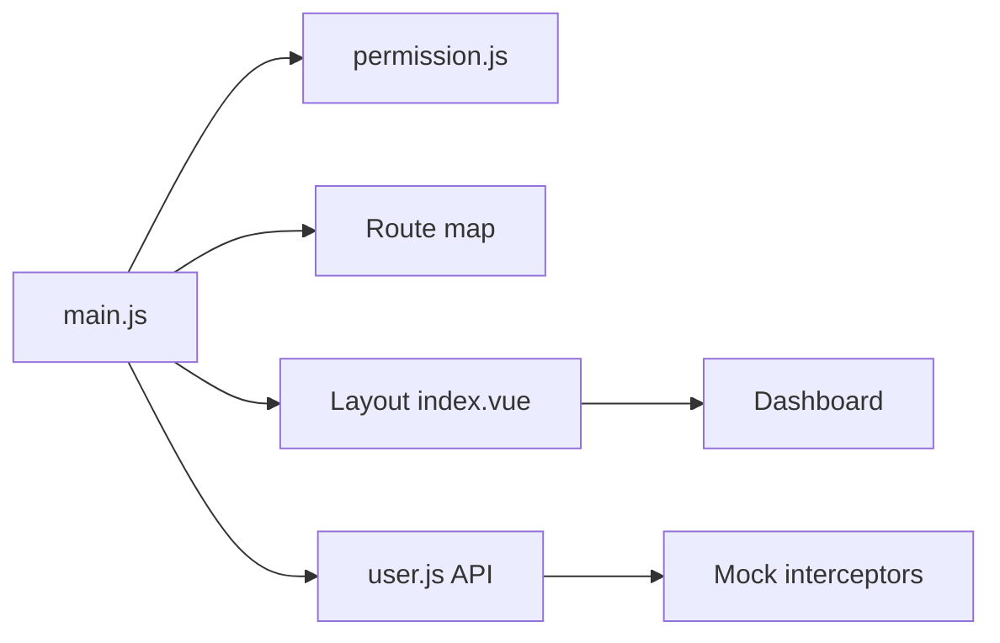

# PanJiaChen/vue-element-admin

> Gabarit d'interface d'administration Vue avec Element UI, permissions et données simulées.

## Le problème
Monter une interface d'administration (connexion, rôles, tableaux, éditeurs) à zéro est long.

## Ce que ça fait vraiment
Application monopage Vue avec routage, garde de permissions par rôle, disposition adaptative, état Vuex, tableaux, éditeurs (texte riche, Markdown, JSON), import et export Excel, graphiques ECharts et i18n sur une branche séparée. Les données sont simulées avec Mock.js. Le README précise que la version 4.x s'appuie sur vue-cli et ne gère pas les vieux navigateurs.

## Comment c'est branché


## Essayer
```bash
git clone https://github.com/PanJiaChen/vue-element-admin.git
cd vue-element-admin
npm install
npm run dev
npm run build:prod
```
Ouvre http://localhost:9527.

## Coût et pièges
Gratuit, MIT. Dernier push le 2024-10-24 (plus d'un an), 1 401 issues ouvertes. Basé sur Vue 2 et Element UI, selon le README.

## Ce que ce n'est pas
Pas une base à jour : l'écosystème a évolué. Les données sont simulées, pas un vrai back-end.

## Alternatives
vue-admin-template (gabarit de base recommandé), electron-vue-admin et vue-typescript-admin-template, cités dans le README.

## Pour toi
À ignorer : pour un tableau de bord de modèles, un outil plus récent et maintenu fera mieux qu'un gabarit Vue 2 à l'arrêt.

