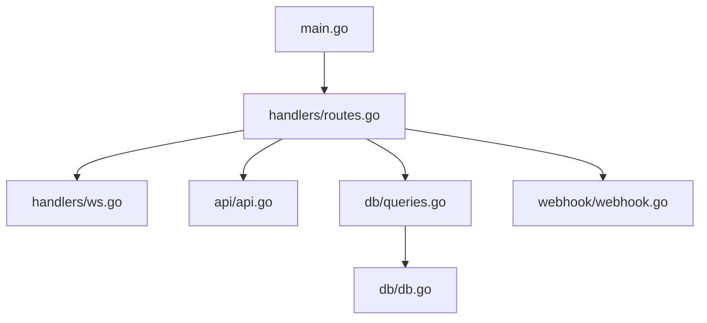

# PanSalut/Koffan

> Lightweight web app for a real-time shared shopping list, for couples and families.

## The problem
Shared shopping lists are heavy, or require accounts and cloud services.

## What it actually does
Go server (Fiber) with HTMX templates, SQLite, WebSocket synchronization, PWA offline mode, multiple lists, a REST API and signed webhooks to n8n or Zapier. Single password by default, accounts and workspaces optional. The author claims about 2.5 MB of RAM.

## How it is wired


## Trying it
```bash
docker run -d -p 3000:8080 -e APP_PASSWORD=yourpassword -v koffan-data:/data ghcr.io/pansalut/koffan:latest
```

## Cost and gotchas
Free. The default password is `shopping123`: change it. Back up the database before 2.16.0 (migration with no way back). Offline mode requires HTTPS, and webhooks are not filtered by workspace.

## What it is not
Not a large-scale multi-household platform: the login rate limiter shares one limit per IP behind a proxy.

## Alternatives
No alternative cited in the README.

## For you
Ignore: well-made home app, but unrelated to data, AI or MLOps work.
