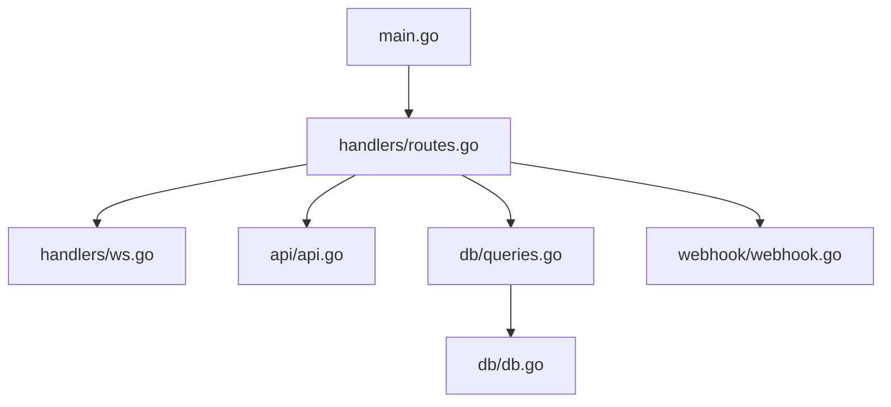

# PanSalut/Koffan

> Application web légère de liste de courses partagée en temps réel, pour couples et familles.

## Le problème
Les listes de courses partagées sont lourdes, ou demandent des comptes et des services cloud.

## Ce que ça fait vraiment
Serveur Go (Fiber) avec gabarits HTMX, SQLite, synchronisation WebSocket, mode hors ligne PWA, plusieurs listes, API REST et webhooks signés vers n8n ou Zapier. Mot de passe unique par défaut, comptes et espaces de travail en option. L'auteur annonce environ 2,5 Mo de RAM.

## Comment c'est branché


## Essayer
```bash
docker run -d -p 3000:8080 -e APP_PASSWORD=yourpassword -v koffan-data:/data ghcr.io/pansalut/koffan:latest
```

## Coût et pièges
Gratuit. Le mot de passe par défaut est `shopping123` : à changer. Sauvegarder la base avant la 2.16.0 (migration sans retour). Le mode hors ligne exige HTTPS, et les webhooks ne sont pas filtrés par espace de travail.

## Ce que ce n'est pas
Pas une plateforme multi-foyers à grande échelle : le limiteur de connexion partage une limite par IP derrière un proxy.

## Alternatives
Aucune alternative citée dans le README.

## Pour toi
Ignorer : application domestique bien faite, mais sans rapport avec un travail data, IA ou MLOps.

