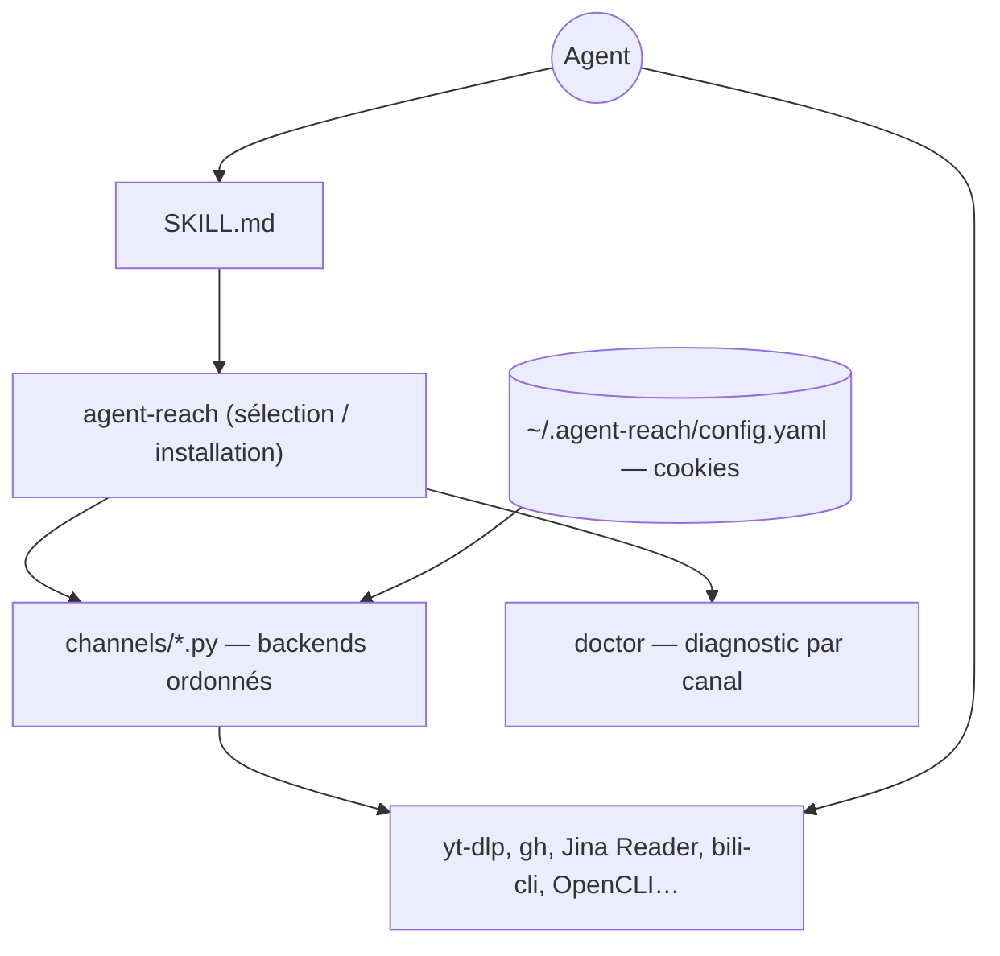

# Panniantong/Agent-Reach

> Installation guide that provides an agent with access to locked web platforms, in Chinese.

## The problem
An agent may be able to code, but they may not be familiar with platforms like Twitter, Reddit, Bilibili, or Xiaohongshu.

Each platform has its own barrier to entry: a paid API, server IP blocking, or mandatory connection requirements.

## What it actually does
He doesn't read anything himself; instead, he selects, installs, and diagnoses the tools upstream, and then the agent calls them.
Each platform is a sorted list of backends (preferred and backup) in a `channels/*.py` file.
The `agent-reach doctor` command actually probes each backend and tells you which one is active and how to fix it.
Six channels function without configuration (web, YouTube, RSS, public GitHub, Exa search, V2EX).

## How it is wired


## Trying it
```bash
agent-reach install --env=auto --dry-run
agent-reach install --env=auto --system
agent-reach doctor
agent-reach uninstall --dry-run
```

## Cost and gotchas
Free; only a proxy server (around $1/month) might incur a cost. Cookies remain local in `600`.

The README warns: calls using cookies expose you to being blocked – use a secondary account.

## What it is not
Not a stable abstraction layer: the backends change when platforms tighten their restrictions.
Not legally neutral – several channels explicitly circumvent access restrictions.
Entirely in Chinese, with no declared license.

## Alternatives
- `unclecode/crawl4ai`: for open web crawling, without requiring authenticated sessions.
- `browser-use/browser-use`: Controls a real browser, with an existing Chrome profile.

## For you
Focus on Chinese platforms, unclear legal framework, and lack of licensing. Should be ignored.
