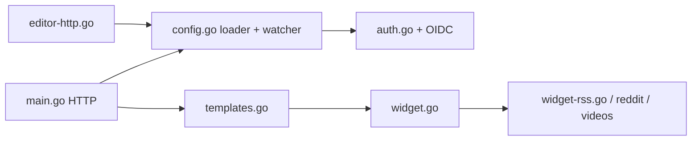

# Panonim/dynacat

> Lightweight self-hosted dashboard, configurable in YAML, with a graphical editor, for following feeds and services.

## The problem
Following RSS, Reddit, weather, markets and container status means opening as many tabs as there are sources.

## What it actually does
A single Go binary (under 20 MB) that reads a YAML file and renders an HTML page with widgets (RSS, Hacker News, Reddit, YouTube, Twitch, markets, Docker status, server statistics, todo, custom widgets), multiple pages and themes. A built-in editor rewrites the same YAML. Optional OIDC authentication, SQLite state for some widgets.

## How it is wired


## Trying it
```bash
mkdir dynacat && cd dynacat && \
curl -sL https://github.com/Panonim/dynacat-compose-template/releases/latest/download/dynacat.tar.gz | tar -xzf - && \
docker compose up -d
```

## Cost and gotchas
Free. Port 8080 is exposed; mounting the Docker socket gives access to the engine for the container widget. An overly restrictive blocking DNS (Pi-hole) causes delays, and Dark Reader breaks the layout.

## What it is not
Not a monitoring or alerting tool: it displays, it does not watch. AGPL-3.0, with the obligations of modified hosting.

## Alternatives
Homepage, cited in the README as a possible host for a Dynacat iframe.

## For you
Ignore: a personal watch dashboard unrelated to data/AI/MLOps work.
