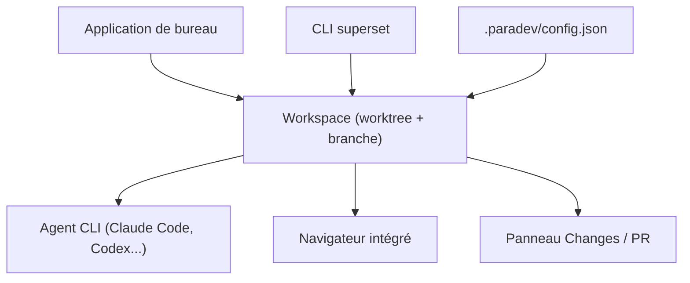

# ParadevAI/Paradev

> Desktop application to run several CLI coding agents in parallel, each in its own Git worktree.

## The problem
A terminal agent works on a single checkout. Running several tasks in parallel forces you to juggle tabs and branches by hand.

## What it actually does
Each task gets a worktree, a branch and terminals. The app offers a changes panel (review, commit, PR), a built-in browser with ports detected per workspace, and agent status. It is not an agent: you bring your own subscriptions and keys. Automations, remote access and the iOS app belong to the Pro plan.

## How it is wired


## Trying it
```bash
curl -fsSL https://paradev.com/cli/install.sh | sh
# ou
brew install paradevai/tap/superset
```

## Cost and gotchas
Agents are at your expense (subscriptions or keys). Pro plan for mobile, automations and remote access. macOS primarily, Linux experimental, Windows absent. Worktrees do not sandbox processes.

## What it is not
Not a coding agent nor a model proxy. Unrelated to Apache Superset. Worktrees do not prevent merge conflicts.

## Alternatives
The README compares it to Cursor, Codex app and Conductor, without detail.

## For you
Worth watching: relevant if you orchestrate several agents on one repository, but mostly macOS and with a paid tier.
