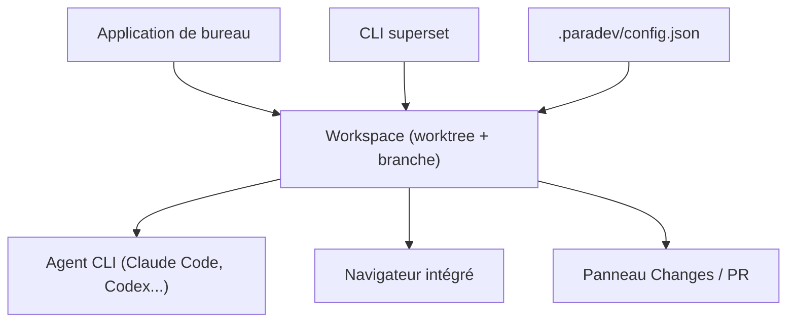

# ParadevAI/Paradev

> Application de bureau pour lancer plusieurs agents CLI de code en parallèle, chacun dans son worktree Git.

## Le problème
Un agent en terminal travaille sur un seul checkout. Lancer plusieurs tâches en parallèle oblige à jongler à la main avec onglets et branches.

## Ce que ça fait vraiment
Chaque tâche reçoit un worktree, une branche et des terminaux. L'app offre un panneau de changements (revue, commit, PR), un navigateur intégré avec ports détectés par workspace, et l'état des agents. Elle n'est pas un agent : tu apportes tes abonnements et clés. Automations, accès distant et app iOS relèvent du plan Pro.

## Comment c'est branché


## Essayer
```bash
curl -fsSL https://paradev.com/cli/install.sh | sh
# ou
brew install paradevai/tap/superset
```

## Coût et pièges
Agents à ta charge (abonnements ou clés). Plan Pro pour mobile, automations et accès distant. macOS principal, Linux expérimental, Windows absent. Les worktrees ne sandboxent pas les processus.

## Ce que ce n'est pas
Pas un agent de code ni un proxy de modèles. Sans lien avec Apache Superset. Les worktrees n'évitent pas les conflits de fusion.

## Alternatives
Le README compare à Cursor, Codex app et Conductor, sans détail.

## Pour toi
À surveiller : pertinent si tu orchestres plusieurs agents sur un dépôt, mais surtout macOS et un volet payant.

