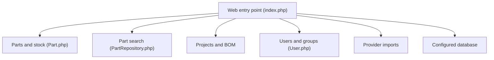

# Part-DB/Part-DB-server

> A web inventory manager for electronic components, for hobbyists, shared workshops and small teams.

## The problem
A stock of components (references, locations, datasheets, prices) quickly gets lost in spreadsheets and drawers.

## What it actually does
A PHP Symfony application accessible through a browser. It organizes parts by category, footprint, manufacturer and location, generates labels with barcodes, manages projects with a bill of materials, an event log, fine-grained permissions and a REST API. It integrates with KiCad, fetches data from suppliers, extracts datasheets with AI and exposes an MCP server.

## How it is wired
Simplified diagram based on the code's diagram.



## Trying it
```bash
cp .env .env.local
composer install -o --no-dev
yarn install
yarn build
php bin/console doctrine:migrations:migrate
```

## Cost and gotchas
Free. You need a web server with PHP 8.2, a MySQL, PostgreSQL or SQLite database, and Node 22 to build the assets. The migration touches the database: back up first. AI extraction assumes an external provider.

## What it is not
It is not a general-purpose inventory tool: it targets electronics. It is not a lightweight project, with more than 200 open issues.

## Alternatives
No alternative named in the README.

## For you
Ignore for a data / AI / MLOps profile: the tool is for organizing electronic components, unless you are setting up a hardware workshop.
