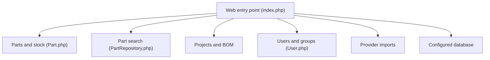

# Part-DB/Part-DB-server

> Gestionnaire d'inventaire web de composants électroniques, pour bricoleurs, ateliers partagés et petites équipes.

## Le problème
Un stock de composants (références, emplacements, fiches techniques, prix) se perd vite dans des tableurs et des tiroirs.

## Ce que ça fait vraiment
Une application PHP Symfony accessible par navigateur. Elle range les pièces par catégorie, empreinte, fabricant et emplacement, génère des étiquettes avec codes-barres, gère des projets avec nomenclature, un journal des événements, des droits fins et une API REST. Elle s'intègre à KiCad, récupère des données chez des fournisseurs, extrait des fiches techniques par IA et expose un serveur MCP.

## Comment c'est branché
Schéma simplifié d'après le diagramme du code.



## Essayer
```bash
cp .env .env.local
composer install -o --no-dev
yarn install
yarn build
php bin/console doctrine:migrations:migrate
```

## Coût et pièges
Gratuit. Il faut un serveur web avec PHP 8.2, une base MySQL, PostgreSQL ou SQLite, et Node 22 pour construire les assets. La migration touche la base : sauvegarde avant. L'extraction par IA suppose un fournisseur externe.

## Ce que ce n'est pas
Ce n'est pas un outil d'inventaire généraliste : il vise l'électronique. Ce n'est pas un projet léger, avec plus de 200 issues ouvertes.

## Alternatives
Aucune alternative nommée dans le README.

## Pour toi
À ignorer pour un profil data / IA / MLOps : l'outil sert à ranger des composants électroniques, sauf si tu montes un atelier matériel.

