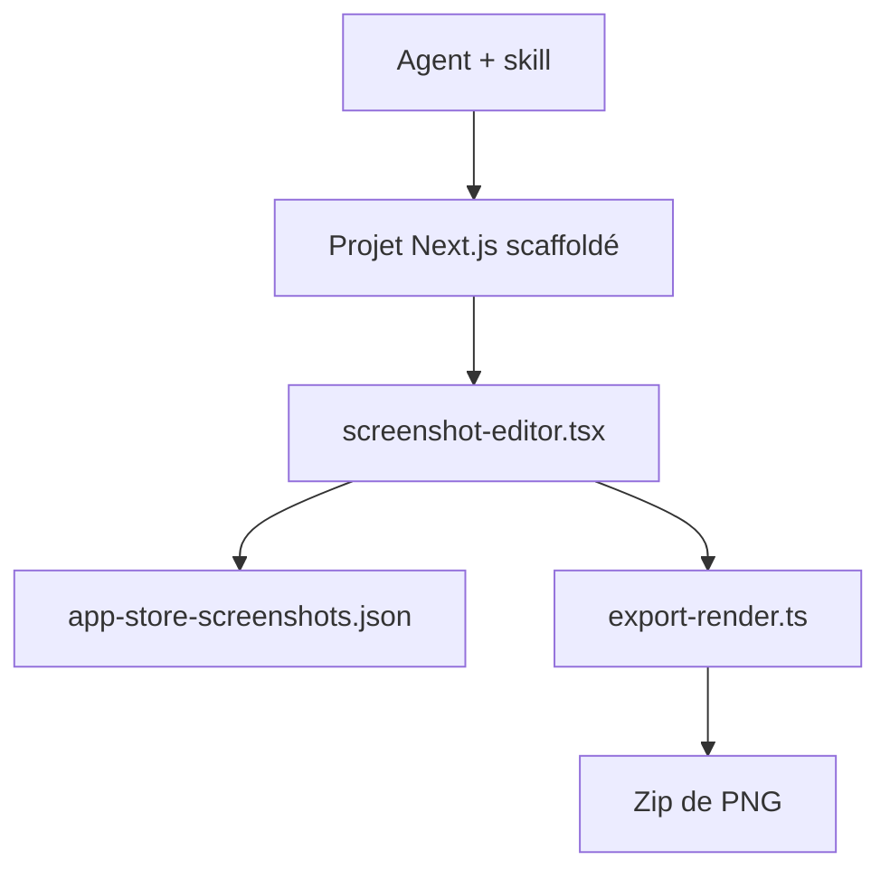

# ParthJadhav/app-store-screenshots

> Skill for coding agents that generates a Next.js editor for App Store and Google Play screenshots.

## The problem
Producing marketing screenshots by hand at the exact dimensions required by the App Store, the Mac App Store and Google Play.

## What it actually does
The skill asks for the app's context, then scaffolds a Next.js project with a connected canvas, Apple device frames, an inspector and styles. State is saved in `app-store-screenshots.json`. Export produces a zip of PNGs at the sizes required per platform, device and language. 18 visual styles are provided.

## How it is wired


## Trying it
```bash
npx skills add ParthJadhav/app-store-screenshots
npx skills add ParthJadhav/app-store-screenshots -a claude-code
```
Then ask: "Build App Store and Google Play screenshots for my app."

## Cost and gotchas
Free. Node.js 20.9+ and a package manager (bun, pnpm, yarn or npm). The Apple frames are licensed only for mockups of apps for Apple platforms.

## What it is not
Not a capture tool: you must supply your own screenshots. It publishes nothing to the stores.

## Alternatives
No alternative named in the README.

## For you
Ignore: useful to mobile app developers, unrelated to data/AI/MLOps work.
