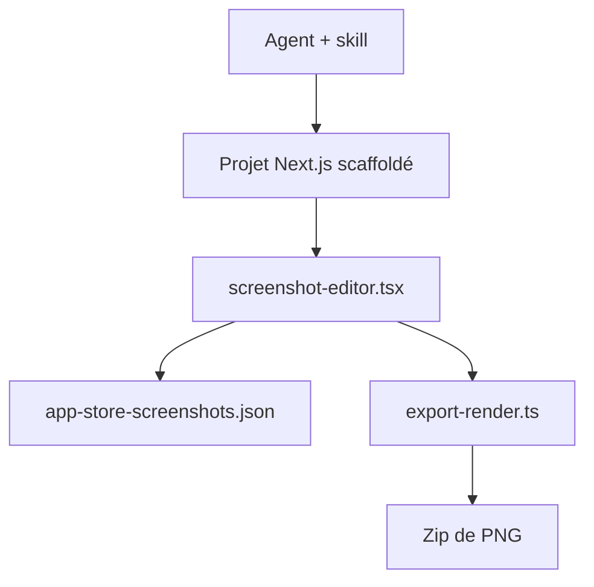

# ParthJadhav/app-store-screenshots

> Skill pour agents de code qui génère un éditeur Next.js de captures App Store et Google Play.

## Le problème
Produire à la main des captures marketing aux dimensions exactes exigées par l'App Store, le Mac App Store et Google Play.

## Ce que ça fait vraiment
Le skill demande le contexte de l'app, puis scaffolde un projet Next.js avec canevas connecté, cadres d'appareils Apple, inspecteur et styles. L'état est sauvé dans `app-store-screenshots.json`. L'export produit un zip de PNG aux tailles requises par plateforme, appareil et langue. 18 styles visuels sont fournis.

## Comment c'est branché


## Essayer
```bash
npx skills add ParthJadhav/app-store-screenshots
npx skills add ParthJadhav/app-store-screenshots -a claude-code
```
Puis demander : « Build App Store and Google Play screenshots for my app. »

## Coût et pièges
Gratuit. Node.js 20.9+ et un gestionnaire (bun, pnpm, yarn ou npm). Les cadres Apple ne sont licenciés que pour des maquettes d'apps pour plateformes Apple.

## Ce que ce n'est pas
Pas un outil de capture : il faut fournir ses propres captures d'écran. Il ne publie rien dans les stores.

## Alternatives
Aucune alternative nommée dans le README.

## Pour toi
À ignorer : utile aux développeurs d'apps mobiles, sans rapport avec un travail data/IA/MLOps.

