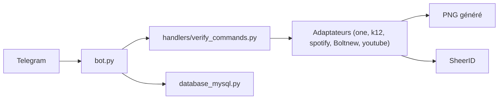

# PastKing/tgbot-verify

> Telegram bot that fabricates fake credentials to pass SheerID student or teacher verification.

## The problem
The README aims at obtaining offers reserved for students or teachers (Gemini, ChatGPT, Spotify, Bolt.new) without being entitled to them.

## What it actually does
From a SheerID URL, the bot generates a fictitious identity and student or teacher card images, then submits them to SheerID. It adds credit management (check-in, invitation, key cards), a MySQL database and admin commands. Each service's `programId` changes and must be updated by hand.

## How it is wired

## Trying it
Commands deliberately not reproduced: the tool is used to forge credentials to bypass an identity verification.

## Cost and gotchas
Telegram bot, MySQL 5.7+, Playwright. Use contravenes the terms of the targeted services and carries legal risk; the `programId` values expire.

## What it is not
Not a legitimate verification tool: it circumvents verification. The README is in Chinese and no safeguard is described.

## Alternatives
No alternative named in the README.

## For you
Ignore: a credential-fraud tool, with no legitimate professional use for a data/AI/MLOps profile.
