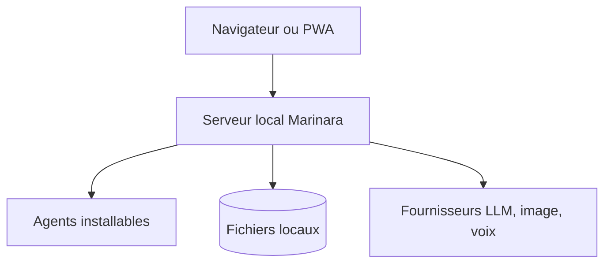

# Pasta-Devs/Marinara-Engine

> Local engine for chat, role-playing and AI games, for interactive fiction enthusiasts.

## The problem
Running AI role-play forces you to cobble together prompts, memory, images and characters across separate tools.

## What it actually does
Three modes: conversation, role-play and AI game master. Installable agents track the world, continuity, images and music. It connects to many model providers, to local models (Ollama, LM Studio) and to existing subscriptions. Data stays on your machine, stored in files.

## How it is wired
Simplified diagram based on the sheet, no diagram provided.



## Trying it
```bash
pnpm reset-login
docker exec <conteneur> node scripts/reset-login.mjs
```
No installation command in the README: the per-platform guides are external.

## Cost and gotchas
API keys for models, images and voice are at your expense; they are encrypted with AES-256. Software in beta: breaking changes possible. LAN access requires a login.

## What it is not
Not a productivity tool nor a development framework. The AGPL license requires sharing the code if publicly hosted.

## Alternatives
- SillyTavern: the README describes an import and a theme inspired by it.

## For you
Ignore: interactive fiction entertainment, outside your data / AI / MLOps scope.
