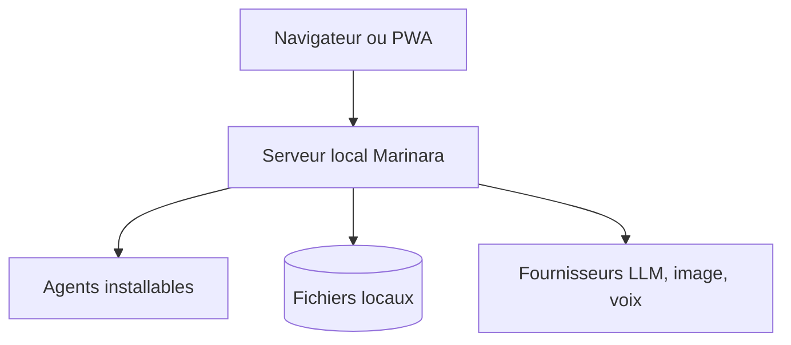

# Pasta-Devs/Marinara-Engine

> Moteur local de chat, jeu de rôle et jeu avec IA, pour passionnés de fiction interactive.

## Le problème
Mener des jeux de rôle avec IA oblige à bricoler prompts, mémoire, images et personnages dans des outils séparés.

## Ce que ça fait vraiment
Trois modes : conversation, jeu de rôle et maître de jeu IA. Des agents installables suivent le monde, la continuité, les images et la musique. Il se connecte à de nombreux fournisseurs de modèles, à des modèles locaux (Ollama, LM Studio) et à des abonnements existants. Les données restent sur ta machine, stockage en fichiers.

## Comment c'est branché
Schéma simplifié d'après la fiche, sans diagramme fourni.



## Essayer
```bash
pnpm reset-login
docker exec <conteneur> node scripts/reset-login.mjs
```
Aucune commande d'installation dans le README : les guides par plateforme sont externes.

## Coût et pièges
Les clés d'API des modèles, images et voix sont à ta charge ; elles sont chiffrées en AES-256. Logiciel en bêta : changements cassants possibles. L'accès LAN demande une connexion.

## Ce que ce n'est pas
Pas un outil de productivité ni un cadre de développement. La licence AGPL impose le partage du code en cas d'hébergement public.

## Alternatives
- SillyTavern : le README décrit un import et un thème inspirés.

## Pour toi
À ignorer : divertissement de fiction interactive, hors de ton périmètre data / IA / MLOps.

