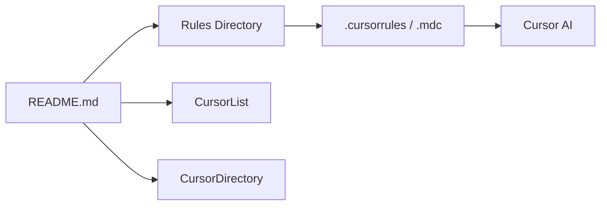

# PatrickJS/awesome-cursorrules

> List of project rules for the Cursor editor, sorted by technology, for developers who guide the AI.

## The problem
A coding assistant without project-specific guidelines produces code that follows neither the tech stack nor the team's style.

## What it actually does
A catalog of `.mdc` files to copy into `.cursor/rules/`, sorted by category: frontend, backend, mobile, games, CSS, state, database/API, testing, deployment, tooling, languages, security, documentation. It also includes rules for Python, PyTorch, TensorFlow, pandas, PySpark, AutoML and Snowflake. Some entries are backed by sponsors or carry third-party services.

## How it is wired


## Trying it
```bash
# Aucune commande : créer .cursor/rules/, y copier le .mdc choisi, puis l'adapter au projet
```

## Cost and gotchas
Free (CC0-1.0). Rule quality varies by contributor and nothing in the README validates them.

## What it is not
Not an executable tool nor a library: just guideline files. They target Cursor, not other assistants.

## Alternatives
- CursorList: rules directory cited in the README.
- CursorDirectory: another cited directory.

## For you
Watch: pick ideas for Python and ML guidelines, to transpose into your own instruction files, rather than copying everything.
