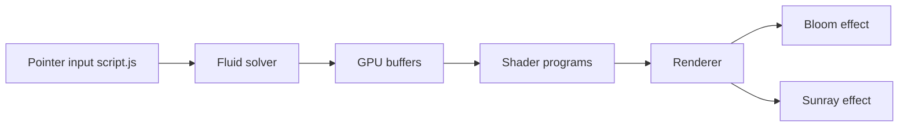

# PavelDoGreat/WebGL-Fluid-Simulation

> Fluid simulation in WebGL in the browser, interactive with the mouse.

## The problem
Not documented in the README: the intent is a demonstration of fluid dynamics on the GPU.

## What it actually does
Minimal README (a "Play here" link and three references, one of them an NVIDIA GPU Gems chapter). From the code as described: a single `script.js` file handles pointer input, settings, the GPU solver, buffers, shaders, and bloom and sunray effects.

## How it is wired


## Trying it
```bash
# Aucune commande documentée.
```

## Cost and gotchas
Free (MIT). Last push in November 2024. README too short to judge browser compatibility.

## What it is not
Not a reusable library: everything is in a single script; not a rigorous physics simulator.

## Alternatives
References cited in the README: mharrys/fluids-2d and haxiomic/GPU-Fluid-Experiments.

## For you
A graphics curiosity, readable as an example of GPU computation in shaders; nothing for a data/AI pipeline.
