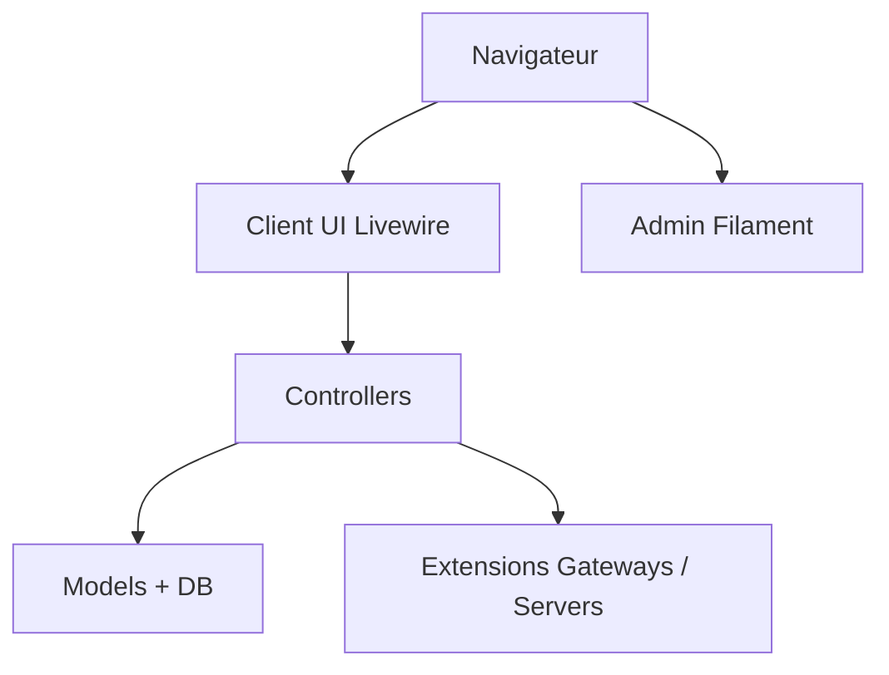

# Paymenter/Paymenter

> Open source billing platform for hosting companies, built on Laravel.

## The problem
A hosting provider has to invoice, collect payments and provision customer servers without developing the whole chain.

## What it actually does
Customer interface and admin panel (Livewire, Filament), orders, invoices, payment gateways (Stripe, PayPal, Mollie) and server integrations (Pterodactyl, Virtualizor) as extensions. Event-driven architecture (events, listeners, jobs).

## How it is wired

## Trying it
No command in the README; it points to the documentation.

## Cost and gotchas
Free. Prerequisites: PHP 8.3+, Composer, Apache or Nginx, MariaDB. Payment gateways have their own fees.

## What it is not
Not a general-purpose SaaS billing tool documented here: it is designed for hosting.

## Alternatives
No alternative named in the README.

## For you
Ignore: hosting-provider billing, outside the data/AI/MLOps scope.
