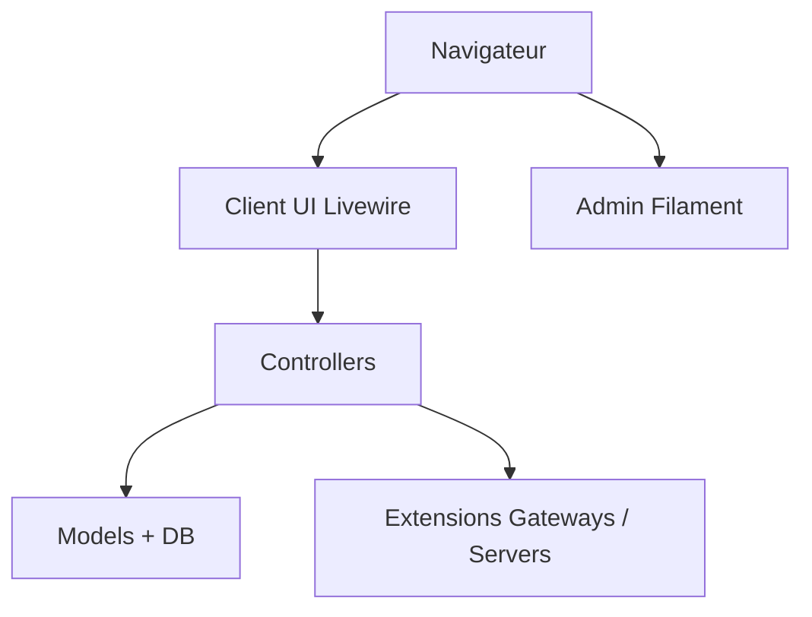

# Paymenter/Paymenter

> Plateforme de facturation open source pour sociétés d'hébergement, bâtie sur Laravel.

## Le problème
Un hébergeur doit facturer, encaisser et provisionner des serveurs clients sans développer toute la chaîne.

## Ce que ça fait vraiment
Interface client et panneau d'administration (Livewire, Filament), commandes, factures, passerelles de paiement (Stripe, PayPal, Mollie) et intégrations serveurs (Pterodactyl, Virtualizor) sous forme d'extensions. Architecture événementielle (événements, listeners, jobs).

## Comment c'est branché

## Essayer
Aucune commande dans le README ; il renvoie à la documentation.

## Coût et pièges
Gratuit. Prérequis : PHP 8.3+, Composer, Apache ou Nginx, MariaDB. Les passerelles de paiement ont leurs propres frais.

## Ce que ce n'est pas
Pas un outil généraliste de facturation SaaS documenté ici : il est pensé pour l'hébergement.

## Alternatives
Aucune alternative nommée dans le README.

## Pour toi
À ignorer : facturation d'hébergeur, hors périmètre data/IA/MLOps.

