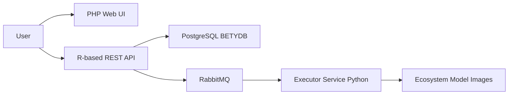

# PecanProject/pecan

> Workflow toolkit and Bayesian data assimilation for ecosystem modeling.

## The problem
Ecosystem models depend on heterogeneous data and their workflows are hard to reproduce.

## What it actually does
PEcAn is not a model: it wraps more than a dozen ecosystem models through wrappers, handles data ingestion, meta-analysis, uncertainty and assimilation. R packages carry the logic, an R API (plumber), a legacy PHP interface and Shiny applications expose the results. A Python executor consumes RabbitMQ tasks and launches model containers, with a PostgreSQL database (BETYdb).

## How it is wired


## Trying it
```R
options(repos = c(
  pecanproject = 'https://pecanproject.r-universe.dev',
  CRAN = 'https://cloud.r-project.org'))
install.packages('PEcAn.all')
```
Docker is recommended for development and production.

## Cost and gotchas
Free. Some functions are limited without the BETYdb database. The web interface is legacy: the README recommends the Quarto tutorials. 481 open issues. License present but not identified by GitHub.

## What it is not
Not an ecosystem model. Not a general-purpose MLOps platform.

## Alternatives
The README names no alternative.

## For you
Ignore: a framework specialized in ecology, with no direct link to your data, AI or MLOps profile unless you need ecosystem modeling.
