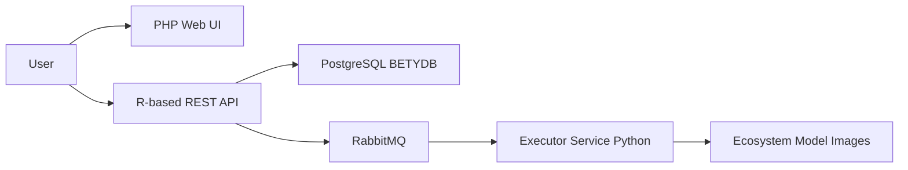

# PecanProject/pecan

> Boîte à outils de workflows et d'assimilation bayésienne de données pour la modélisation des écosystèmes.

## Le problème
Les modèles d'écosystème dépendent de données hétérogènes et leurs workflows sont difficiles à reproduire.

## Ce que ça fait vraiment
PEcAn n'est pas un modèle : il encadre plus d'une dizaine de modèles d'écosystème via des wrappers, gère l'ingestion de données, la méta-analyse, l'incertitude et l'assimilation. Des paquets R portent la logique, une API R (plumber), une interface PHP historique et des applications Shiny exposent les résultats. Un exécuteur Python consomme les tâches RabbitMQ et lance des conteneurs de modèle, avec une base PostgreSQL (BETYdb).

## Comment c'est branché


## Essayer
```R
options(repos = c(
  pecanproject = 'https://pecanproject.r-universe.dev',
  CRAN = 'https://cloud.r-project.org'))
install.packages('PEcAn.all')
```
Docker est recommandé pour le développement et la production.

## Coût et pièges
Gratuit. Certaines fonctions sont limitées sans la base BETYdb. L'interface web est héritée : le README recommande les tutoriels Quarto. 481 issues ouvertes. Licence présente mais non identifiée par GitHub.

## Ce que ce n'est pas
Pas un modèle d'écosystème. Pas une plateforme MLOps généraliste.

## Alternatives
Le README ne nomme pas d'alternative.

## Pour toi
Ignorer : cadre spécialisé en écologie, sans lien direct avec ton profil data, IA ou MLOps hors besoin de modélisation d'écosystèmes.

