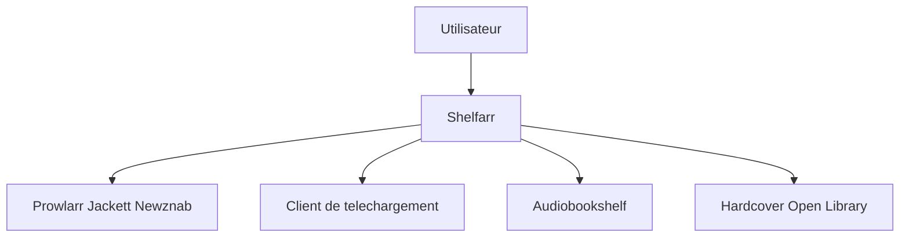

# Pedro-Revez-Silva/shelfarr

> Self-hosted ebook and audiobook request manager for the *arr ecosystem, a "Jellyseerr for books".

## The problem
Automating the search, download and filing of books means juggling indexers, clients and a library.

## What it actually does
Users request a book; Shelfarr searches via Prowlarr, Jackett or Newznab, downloads with qBittorrent, SABnzbd or other clients, then files the files and delivers them to Audiobookshelf, BookOrbit or Grimmory. Direct sources: Anna's Archive, Z-Library, LibriVox. Multi-user, OIDC, 2FA, REST API, notifications.

## How it is wired

Simplified diagram based on the fiche, no diagram provided.

## Trying it
```bash
mkdir shelfarr && cd shelfarr
curl -O https://raw.githubusercontent.com/Pedro-Revez-Silva/shelfarr/main/docker-compose.example.yml
mv docker-compose.example.yml docker-compose.yml
docker compose up -d
```

## Cost and gotchas
Free, but you must configure indexers and download clients. The first user to sign up becomes admin. The application relies on sources such as Anna's Archive and Z-Library, whose legality depends on the country and the content. Ruby 3.3 for development. GPL-3.0.

## What it is not
Not a book reader or a catalog. Not a work tool.

## Alternatives
- Jellyseerr: the equivalent for video, cited as the model.

## For you
Ignore: a personal media-library tool unrelated to your work.
