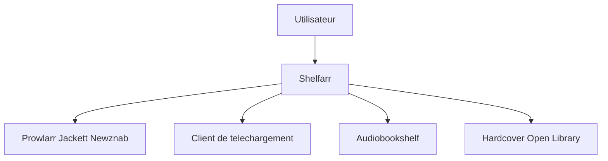

# Pedro-Revez-Silva/shelfarr

> Gestionnaire auto-hébergé de demandes d'ebooks et audiolivres pour l'écosystème *arr, version « Jellyseerr pour les livres ».

## Le problème
Automatiser la recherche, le téléchargement et le rangement de livres demande de jongler entre indexeurs, clients et bibliothèque.

## Ce que ça fait vraiment
Les utilisateurs demandent un livre ; Shelfarr cherche via Prowlarr, Jackett ou Newznab, télécharge avec qBittorrent, SABnzbd ou d'autres clients, puis range les fichiers et les livre à Audiobookshelf, BookOrbit ou Grimmory. Sources directes : Anna's Archive, Z-Library, LibriVox. Multi-utilisateur, OIDC, 2FA, API REST, notifications.

## Comment c'est branché

Schéma simplifié d'après la fiche, sans diagramme fourni.

## Essayer
```bash
mkdir shelfarr && cd shelfarr
curl -O https://raw.githubusercontent.com/Pedro-Revez-Silva/shelfarr/main/docker-compose.example.yml
mv docker-compose.example.yml docker-compose.yml
docker compose up -d
```

## Coût et pièges
Gratuit, mais il faut indexeurs et clients de téléchargement à configurer. Le premier inscrit devient admin. L'application s'appuie sur des sources comme Anna's Archive et Z-Library, dont la légalité dépend du pays et des contenus. Ruby 3.3 pour le développement. GPL-3.0.

## Ce que ce n'est pas
Pas un lecteur de livres ni un catalogue. Pas un outil de travail.

## Alternatives
- Jellyseerr : l'équivalent pour la vidéo, cité comme modèle.

## Pour toi
À ignorer : outil de médiathèque personnelle sans rapport avec ton métier.

