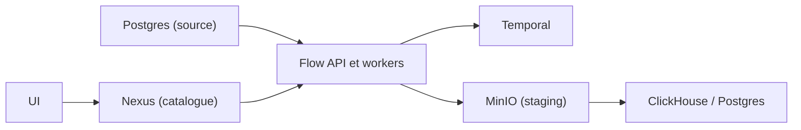

# PeerDB-io/peerdb

> Postgres-to-ClickHouse or Postgres replication via CDC, driven in SQL, for data teams.

## The problem
Getting data out of Postgres into an analytical warehouse without writing a home-grown pipeline, with large volumes, TOAST columns and schema changes.

## What it actually does
"Mirrors" copy Postgres (and MySQL, MongoDB, CockroachDB, BigQuery as sources) to ClickHouse or Postgres. Recommended mode: CDC. The cursor/QRep and XMIN modes are deprecated, as are the Snowflake, BigQuery, Kafka, S3, Elasticsearch, Event Hubs and Pub/Sub destinations. A Postgres-compatible interface (port 9900) is used to create mirrors. Files are staged in MinIO; Temporal orchestrates the workflows.

## How it is wired


## Trying it
```bash
git clone git@github.com:PeerDB-io/peerdb.git
cd peerdb
bash ./run-peerdb.sh
psql "port=9900 host=localhost password=peerdb"
```

## Cost and gotchas
Free when self-hosted, but Docker, Temporal, MinIO and a catalog database run locally. If ClickHouse runs outside Docker, it must be able to reach MinIO (`AWS_ENDPOINT_URL_S3`). 205 open issues.

## What it is not
Not a general-purpose ETL: most destinations are deprecated. The "10x faster" is a README claim not backed up here. AGPL-3.0: obligations if you offer the service to third parties.

## Alternatives
ClickHouse Cloud embeds PeerDB natively (cited in the README).

## For you
Worth watching: useful if you feed ClickHouse from Postgres, but the active scope is narrow and the deployment heavy for a one-off need.
