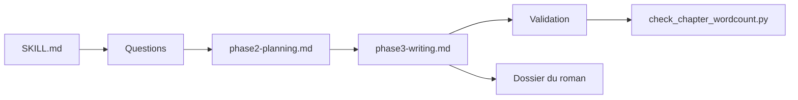

# PenglongHuang/chinese-novelist-skill

> Claude Code skill that guides the writing of a Chinese novel, from questionnaire to validated manuscript.

## The problem
Writing a long novel requires holding a plan, characters and consistency across dozens of chapters, and agent sessions lose that thread.

## What it actually does
A phased flow: initialization (preferences remembered in `user-preferences.json`, resume after interruption), three-level questions, planning (seven-column outline, character sheets, JSON writing plan), mode choice (serial, parallel subagents, Agent Teams), chapter-by-chapter writing (3000 to 5000 characters), then validation (script `check_chapter_wordcount.py`, consistency, rewriting up to 3 times).

## How it is wired


## Trying it
```bash
npx skills add PenglongHuang/chinese-novelist-skill
```
Then: `使用 chinese-novelist 帮我写一部小说`.

## Cost and gotchas
The skill itself is free; writing consumes the tokens of the agent used (cost not quantified in the README). Agent Teams mode assumes Claude Code.

## What it is not
Not a proofreading or translation tool: Chinese creation only. Literary quality is not measured, only length and consistency. Single maintainer, repository from January 2026.

## Alternatives
No alternative named in the README.

## For you
Ignore: outside your data/AI/MLOps profile; only the phased skill design (memory, resume, validation) may serve as an example of structure.
