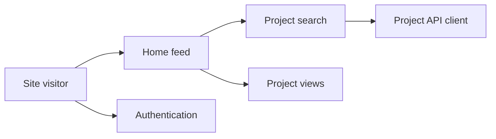

# PenguinMod/PenguinMod-Home

> PenguinMod's home page, with projects and content created by the community.

## The problem
Not documented in the README.

## What it actually does
The README is a single sentence. Judging by the architecture (code), it is a SvelteKit site: home feed, search, profiles, my projects, messages, sign-up and login, project upload, an admin panel, plus a VR rendering module. It depends on a PenguinMod API.

## How it is wired

## Trying it
No documented command.

## Cost and gotchas
Not documented. The PenguinMod API is a third-party service.

## What it is not
Not a standalone project: it is the front end of a platform (a Scratch-style editor) whose backend is not here. No licence declared.

## Alternatives
None cited in the README.

## For you
Ignore: a community front end with no licence and no documentation, unrelated to data, AI or MLOps.
