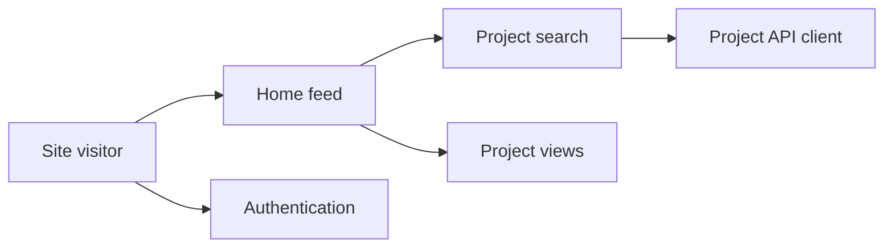

# PenguinMod/PenguinMod-Home

> Page d'accueil de PenguinMod, avec projets et contenus créés par la communauté.

## Le problème
Non documenté dans le README.

## Ce que ça fait vraiment
Le README tient en une phrase. D'après l'architecture (code), c'est un site SvelteKit : flux d'accueil, recherche, profils, mes projets, messages, inscription et connexion, envoi de projets, panneau d'administration, plus un module de rendu VR. Il dépend d'une API PenguinMod.

## Comment c'est branché

## Essayer
Aucune commande documentée.

## Coût et pièges
Non documenté. L'API PenguinMod est un service tiers.

## Ce que ce n'est pas
Pas un projet autonome : c'est le front d'une plateforme (éditeur de type Scratch) dont le backend n'est pas ici. Aucune licence déclarée.

## Alternatives
Aucune citée dans le README.

## Pour toi
Ignorer : un front communautaire sans licence ni documentation, sans rapport avec data, IA ou MLOps.

