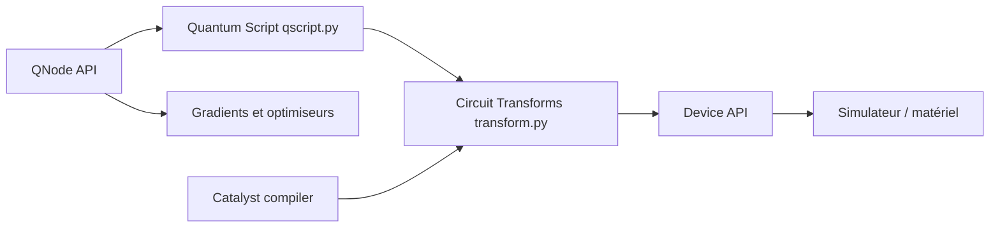

# PennyLaneAI/pennylane

> Python library for designing, differentiating and running quantum circuits, with hybrid machine learning.

## The problem
Writing quantum algorithms (chemistry, optimization, QML) forces you to juggle simulators, hardware and gradient computation.

## What it actually does
You describe operations and measurements in a QNode; they are queued in a quantum script, transformed (compilation), then run on a simulator (Lightning, GPU) or on hardware. Gradient transforms and optimizers are used for training. Modules for chemistry, resource estimation, datasets and circuit drawing complete the set; the Catalyst compiler is mentioned.

## How it is wired


## Trying it
```bash
python -m pip install pennylane
```

## Cost and gotchas
Python 3.12 minimum. GPU simulators and hardware access depend on plugins and on accounts with providers, not detailed in the README. 433 open issues.

## What it is not
It is not a quantum computer: classical simulations hit a ceiling quickly as the number of qubits grows. The README is a presentation text; its claims about the community and speed are not backed up.

## Alternatives
No alternative is cited in the README.

## For you
Worth watching: mature (2018) and active, useful only if you are exploring QML or quantum optimization; with no specific need, there is nothing to take from it.
