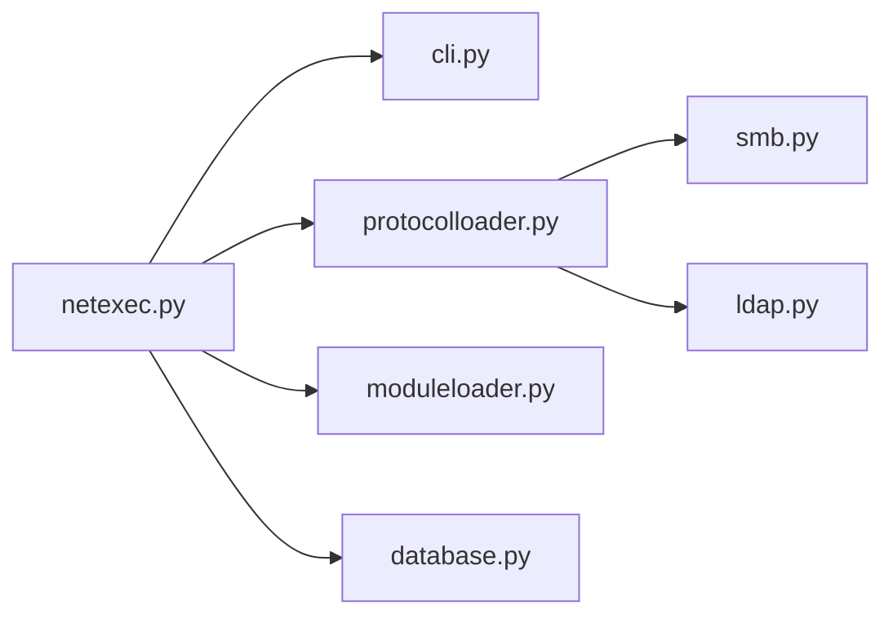

# Pennyw0rth/NetExec

> Command-line tool for assessing enterprise networks, for pentesters and authorized defensive teams.

## The problem
Assessing the security of a fleet of machines and services (Windows, directories, shares) means juggling a different tool for each protocol.

## What it actually does
NetExec is the community successor to CrackMapExec (created in 2015, taken over under this name in September 2023). The user supplies targets, credentials, a protocol and optional modules; the tool loads the protocol handler (SMB, LDAP, others) and the modules, then prints results to the console and keeps per-protocol state in per-workspace databases. The exact call flow is not visible in the excerpts analyzed: not documented here.

## How it is wired


## Trying it
```bash
sudo apt install pipx git
pipx ensurepath
pipx install git+https://github.com/Pennyw0rth/NetExec
```
The README points to the wiki (still being written) for detailed installation and examples.

## Cost and gotchas
Free. Documentation is still a work in progress, 165 open issues. Use only on systems you are responsible for or with explicit authorization: actions against remote services may be illegal without consent.

## What it is not
It is not a monitoring tool or a passive scanner: it authenticates to and interacts with remote services. Nor is it the historical CrackMapExec repository, of which it is the continuation.

## Alternatives
- CrackMapExec: ancestor cited by the README, now replaced by this repository.

## For you
Keep an eye on it: an Active Directory penetration-testing tool with no use in a data/AI pipeline; relevant only if you audit your own environment with a mandate.
