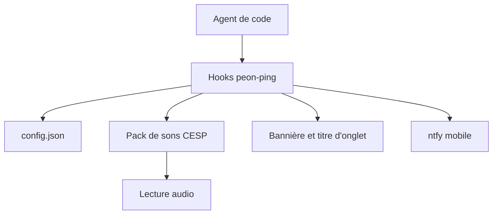

# PeonPing/peon-ping

> Sound notifications and on-screen banners when your coding agent finishes or waits for permission.

## The problem
A coding agent does not tell you when it has finished or is waiting: you switch tabs and lose time.

## What it actually does
Hooks plug into Claude Code, Codex, Cursor, Copilot and others. Depending on the event (start, finish, permission, error, limit reached), a sound from a pack (Warcraft, Portal…) is played with a banner and a tab title. Per-folder and per-IDE rules, `peon` controls, an MCP server and mobile notifications via ntfy. Windows only supports some of the commands.

## How it is wired
Simplified diagram based on the sheet, no diagram provided.



## Trying it
```bash
brew install PeonPing/tap/peon-ping
peon-ping-setup
peon setup
peon packs list
peon toggle
```

## Cost and gotchas
Free. Installing via `curl | bash` runs a remote script. Under WSL2 with Windows 11 24H2+, MP3 packs require ffmpeg.

## What it is not
Not an agent supervision tool: it controls nothing, it only notifies. The packs reuse game universes, with rights not specified in the README.

## Alternatives
No alternative named in the README.

## For you
Worth watching: an inexpensive but real gadget if you leave agents running for a long time, with no technical stake for your work.
