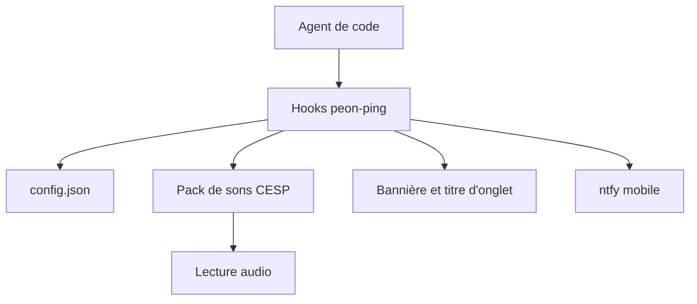

# PeonPing/peon-ping

> Notifications sonores et bannières à l'écran quand ton agent de code termine ou attend une autorisation.

## Le problème
Un agent de code ne prévient pas quand il a fini ou qu'il attend : tu changes d'onglet et perds du temps.

## Ce que ça fait vraiment
Des hooks se branchent sur Claude Code, Codex, Cursor, Copilot et d'autres. Selon l'événement (début, fin, permission, erreur, limite atteinte), un son d'un pack (Warcraft, Portal…) est joué avec une bannière et un titre d'onglet. Règles par dossier, par IDE, contrôles `peon`, serveur MCP et notifications mobiles via ntfy. Windows ne supporte qu'une partie des commandes.

## Comment c'est branché
Schéma simplifié d'après la fiche, sans diagramme fourni.



## Essayer
```bash
brew install PeonPing/tap/peon-ping
peon-ping-setup
peon setup
peon packs list
peon toggle
```

## Coût et pièges
Gratuit. L'installation par `curl | bash` exécute un script distant. Sous WSL2 avec Windows 11 24H2+, les packs MP3 demandent ffmpeg.

## Ce que ce n'est pas
Ce n'est pas un outil de supervision d'agent : il ne contrôle rien, il notifie seulement. Les packs reprennent des univers de jeux, avec droits non précisés dans le README.

## Alternatives
Aucune alternative nommée dans le README.

## Pour toi
À surveiller : gadget peu coûteux mais réel si tu laisses des agents tourner longtemps, sans enjeu technique pour ton métier.

