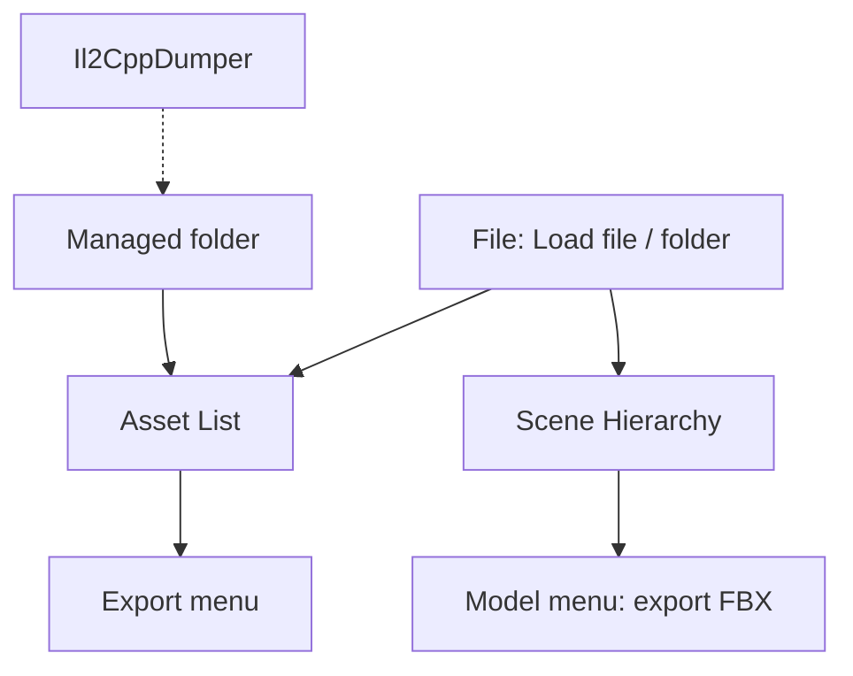

# Perfare/AssetStudio

> Windows explorer that extracts and exports Unity game assets, for modders and reverse engineers.

## The problem
The assets of a Unity game (textures, sounds, models) are locked inside bundles that are unreadable without a dedicated tool.

## What it actually does
Loads assets or AssetBundles, lists them and exports them: Texture2D as png/tga/jpeg/bmp, audio, fonts, meshes as obj, MonoBehaviour as json, Animator as FBX. Unity versions 3.4 to 2022.1. Bundles are decompressed in memory.

## How it is wired
Simplified diagram based on the fiche, no diagram provided.

## Trying it
No command: usage goes through the File, Export and Model menus of the interface.

## Cost and gotchas
Free. Requires .NET Framework 4.7.2, .NET 5 or .NET 6 depending on the variant. In-memory loading is costly for large bundles. Repository archived, last push at the end of 2022. Not affiliated with Unity.

## What it is not
Not a data tool. Not maintained. Respecting the rights of the extracted games is up to you.

## Alternatives
No alternative named in the README (it points to Il2CppDumper by the same author).

## For you
Ignore: used for game modding, outside the data / AI / MLOps scope, and archived.
