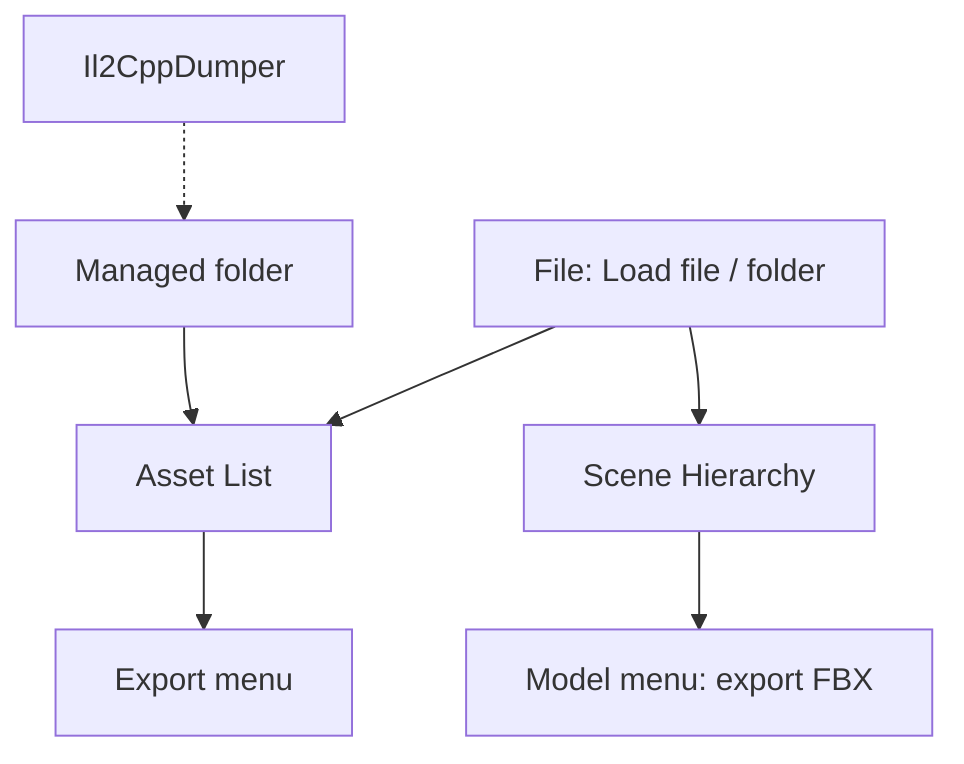

# Perfare/AssetStudio

> Explorateur Windows qui extrait et exporte les ressources de jeux Unity, pour modders et rétro-ingénieurs.

## Le problème
Les assets d'un jeu Unity (textures, sons, modèles) sont enfermés dans des bundles illisibles sans outil dédié.

## Ce que ça fait vraiment
Charge des assets ou AssetBundles, les liste et les exporte : Texture2D en png/tga/jpeg/bmp, audio, polices, maillages en obj, MonoBehaviour en json, Animator en FBX. Versions Unity 3.4 à 2022.1. Les bundles sont décompressés en mémoire.

## Comment c'est branché
Schéma simplifié d'après la fiche, sans diagramme fourni.

## Essayer
Aucune commande : l'usage passe par les menus File, Export et Model de l'interface.

## Coût et pièges
Gratuit. Requiert .NET Framework 4.7.2, .NET 5 ou .NET 6 selon la variante. Chargement en mémoire coûteux pour de gros bundles. Dépôt archivé, push fin 2022. Non affilié à Unity.

## Ce que ce n'est pas
Pas un outil data. Pas maintenu. Respect des droits des jeux extraits à ta charge.

## Alternatives
Aucune alternative nommée dans le README (renvoi vers Il2CppDumper du même auteur).

## Pour toi
Ignorer : sert au modding de jeux, hors périmètre data / IA / MLOps, et archivé.

