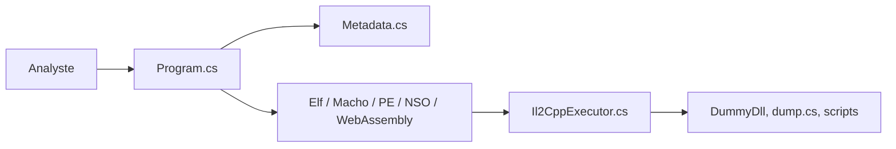

# Perfare/Il2CppDumper

> A reverse-engineering tool that restores metadata from Unity games compiled with IL2CPP.

## The problem
An IL2CPP Unity game ships native code and a `global-metadata.dat` file: without a tool, class and method names are unreadable for the analyst.

## What it actually does
From the executable and `global-metadata.dat`, produces restored DLLs (without the code), `dump.cs`, an `il2cpp.h` header, and scripts for IDA, Ghidra and Binary Ninja. Formats ELF, Mach-O, PE, NSO, WASM; Unity 5.3 to 2022.2. Configuration through `config.json`.

## How it is wired


## Trying it
```bash
Il2CppDumper.exe <executable-file> <global-metadata> <output-directory>
```

## Cost and gotchas
Free, MIT. Last push in August 2024: Unity versions after 2022.2 are not announced. Obfuscated files are not supported.

## What it is not
Neither a full decompiler (the code is not restored) nor a deobfuscation tool.

## Alternatives
Zygisk-Il2CppDumper (same author) for rooted Android devices and `libil2cpp.so` protections.

## For you
Ignore: unrelated to data/AI/MLOps, and the repository has not moved in over a year.
