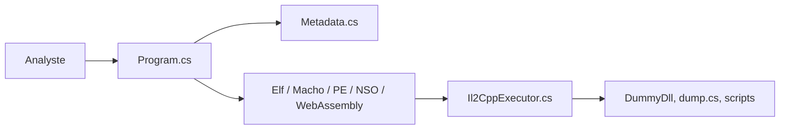

# Perfare/Il2CppDumper

> Outil de rétro-ingénierie qui restaure les métadonnées de jeux Unity compilés en IL2CPP.

## Le problème
Un jeu Unity IL2CPP livre du code natif et un fichier `global-metadata.dat` : sans outil, les noms de classes et méthodes sont illisibles pour l'analyste.

## Ce que ça fait vraiment
À partir de l'exécutable et de `global-metadata.dat`, produit des DLL restaurées (sans le code), `dump.cs`, un en-tête `il2cpp.h`, et des scripts pour IDA, Ghidra et Binary Ninja. Formats ELF, Mach-O, PE, NSO, WASM ; Unity 5.3 à 2022.2. Configuration par `config.json`.

## Comment c'est branché


## Essayer
```bash
Il2CppDumper.exe <executable-file> <global-metadata> <output-directory>
```

## Coût et pièges
Gratuit, MIT. Dernier push en août 2024 : les versions d'Unity postérieures à 2022.2 ne sont pas annoncées. Les fichiers obfusqués ne sont pas pris en charge.

## Ce que ce n'est pas
Ni décompilateur complet (le code n'est pas restauré), ni outil de désobfuscation.

## Alternatives
Zygisk-Il2CppDumper (même auteur) pour les Android rootés et les protections de `libil2cpp.so`.

## Pour toi
Ignorer : sans rapport avec data/IA/MLOps, et le dépôt n'a plus bougé depuis plus d'un an.

