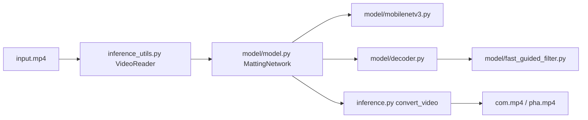

# PeterL1n/RobustVideoMatting

> Real-time, recurrent human video matting model, from a ByteDance paper.

## The problem
Cutting out a person in a video without a green screen or reference image, frame by frame, gives a flickering and slow result.

## What it actually does
`MattingNetwork` (MobileNetV3 or ResNet50 backbone, LR-ASPP, decoder, guided filter) with recurrent states that keep temporal memory between frames. `convert_video` API to produce composition, alpha and foreground. Weights exported to PyTorch, TorchScript, ONNX, TensorFlow, TF.js and CoreML. Measured at 104 FPS in HD on a GTX 1080 Ti (tensor throughput only).

## How it is wired


## Trying it
```bash
pip install -r requirements_inference.txt
```
(The rest of the usage is in Python: `MattingNetwork`, `convert_video` or `torch.hub.load("PeterL1n/RobustVideoMatting", "mobilenetv3")`.)

## Cost and gotchas
GPU recommended; the supplied conversion script is much slower than the announced figures (no hardware encoding). GPL-3.0 license: restrictive for a product.

## What it is not
Not generic object matting: designed for humans. Last push in April 2024, a frozen research project.

## Alternatives
No alternative named; only third-party ports (NCNN Android, lite.ai.toolkit, MNN, TNN) are cited.

## For you
Worth watching: a solid, exportable model for an occasional video need, but outside the data/MLOps core, unchanged since 2024 and under GPL, so to be avoided in a closed product.
