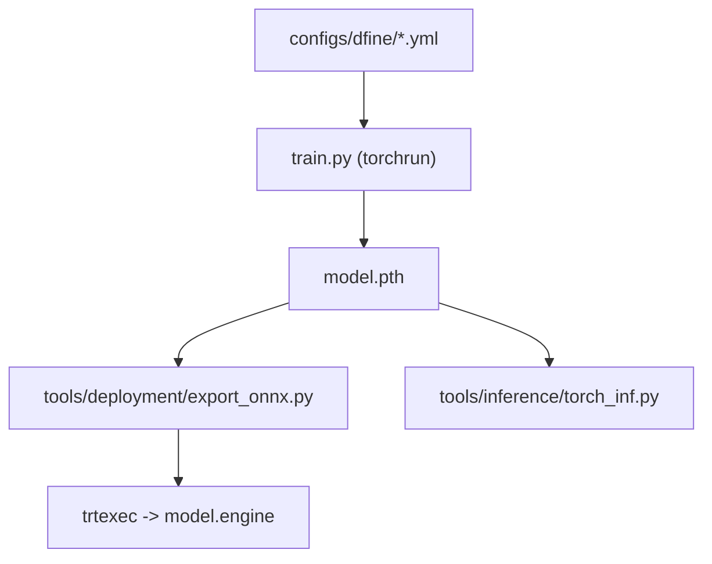

# Peterande/D-FINE

> Real-time DETR-type object detector, with pretrained weights, for those who train or deploy detection.

## The problem
DETRs converge slowly and localize boxes poorly. Real-time detectors of the YOLO family dominated the accuracy/latency trade-off.

## What it actually does
Redefines box regression as a refinement of distributions (FDR) and distills localization from the last layers to the first (GO-LSD). Five sizes (N to X): from 42.8 AP / 4M parameters to 55.8 AP / 62M on COCO; up to 59.3 AP with Objects365 pretraining. Provides training, ONNX/TensorRT export, inference and benchmarking.

## How it is wired
No diagram provided; diagram based on the README.


## Trying it
```bash
conda create -n dfine python=3.11.9
conda activate dfine
pip install -r requirements.txt
export model=l  # n s m l x
CUDA_VISIBLE_DEVICES=0,1,2,3 torchrun --master_port=7777 --nproc_per_node=4 train.py -c configs/dfine/dfine_hgnetv2_${model}_coco.yml --use-amp --seed=0
python tools/inference/torch_inf.py -c configs/dfine/dfine_hgnetv2_${model}_coco.yml -r model.pth --input image.jpg --device cuda:0
```

## Cost and gotchas
The training commands assume 4 GPUs. Objects365 is large and requires manual preparation in 8 steps. Latencies measured on T4 with TensorRT 10.4.

## What it is not
Not a ready-to-use API: you must prepare the data in COCO format. Weights derived from Objects365 may not be free for commercial use (README note), despite the Apache-2.0 license.

## Alternatives
YOLO11 (compared in the README video); DEIM (neighboring repository, same base).

## For you
Adopt for real-time detection: solid COCO figures and a complete export/deployment chain, while checking the Objects365 weights' conditions before commercial use.
