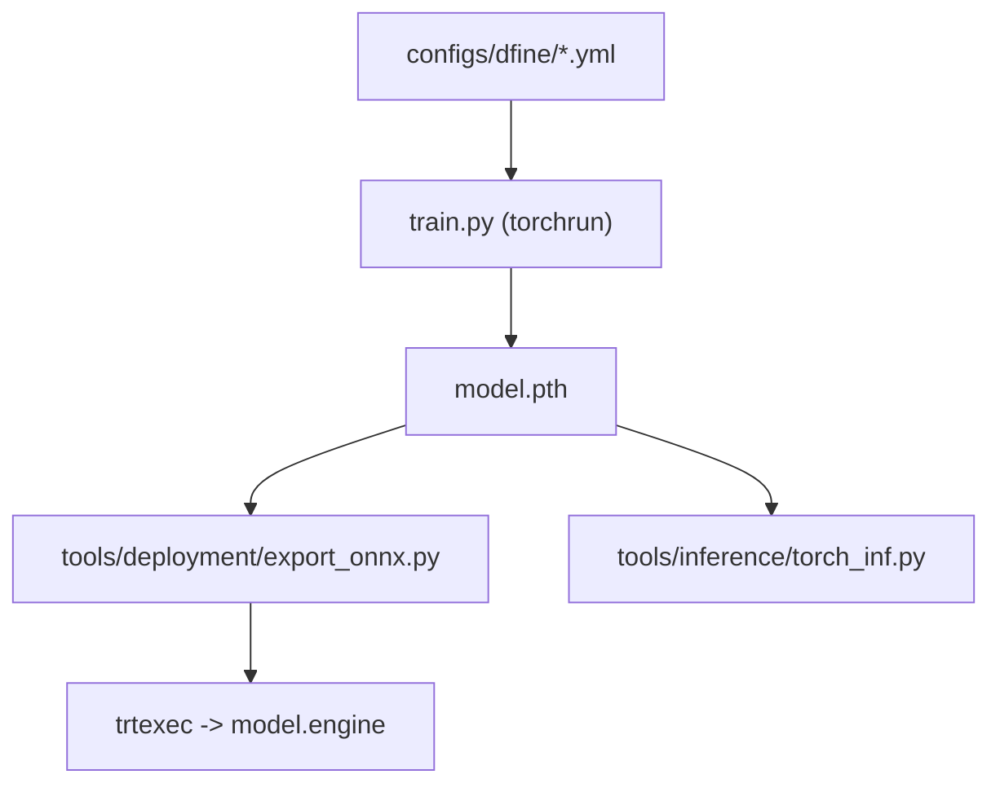

# Peterande/D-FINE

> Détecteur d'objets temps réel de type DETR, avec poids pré-entraînés, pour qui entraîne ou déploie de la détection.

## Le problème
Les DETR convergent lentement et localisent mal les boîtes. Les détecteurs temps réel de la famille YOLO dominaient sur le compromis précision/latence.

## Ce que ça fait vraiment
Redéfinit la régression des boîtes comme un affinage de distributions (FDR) et distille la localisation des dernières couches vers les premières (GO-LSD). Cinq tailles (N à X) : de 42,8 AP / 4M paramètres à 55,8 AP / 62M sur COCO ; jusqu'à 59,3 AP avec pré-entraînement Objects365. Fournit entraînement, export ONNX/TensorRT, inférence et benchmark.

## Comment c'est branché
Pas de diagramme fourni ; schéma d'après le README.


## Essayer
```bash
conda create -n dfine python=3.11.9
conda activate dfine
pip install -r requirements.txt
export model=l  # n s m l x
CUDA_VISIBLE_DEVICES=0,1,2,3 torchrun --master_port=7777 --nproc_per_node=4 train.py -c configs/dfine/dfine_hgnetv2_${model}_coco.yml --use-amp --seed=0
python tools/inference/torch_inf.py -c configs/dfine/dfine_hgnetv2_${model}_coco.yml -r model.pth --input image.jpg --device cuda:0
```

## Coût et pièges
Les commandes d'entraînement supposent 4 GPU. Objects365 est volumineux et demande une préparation manuelle en 8 étapes. Latences mesurées sur T4 avec TensorRT 10.4.

## Ce que ce n'est pas
Ce n'est pas une API prête à l'emploi : il faut préparer les données au format COCO. Les poids issus d'Objects365 peuvent ne pas être libres pour un usage commercial (note du README), malgré la licence Apache-2.0.

## Alternatives
YOLO11 (comparé dans la vidéo du README) ; DEIM (dépôt voisin, même base).

## Pour toi
Adopter pour de la détection temps réel : chiffres COCO solides et chaîne export/déploiement complète, en vérifiant les conditions des poids Objects365 avant usage commercial.

