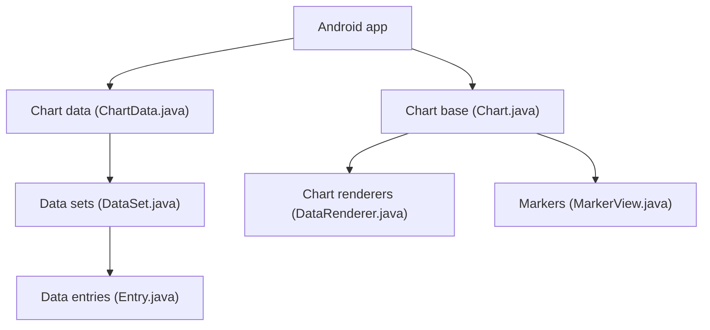

# PhilJay/MPAndroidChart

> Chart library for Android, rewritten in Kotlin, with a Jetpack Compose module.

## The problem
Drawing interactive charts on Android by hand is slow: axes, zoom, selection, animations.

## What it actually does
Nine chart types (line, bar, pie, scatter, candlestick, bubble, radar, combined). Zoom, drag, highlighting, markers, animations, formatters. Property-based API, composable functions in Compose, 35 chapters of guides. The README claims 30,000 points rendered smoothly.

## How it is wired


## Trying it
```kotlin
// settings.gradle.kts
dependencyResolutionManagement { repositories { maven("https://jitpack.io") } }
// build.gradle.kts
implementation("com.github.PhilJay.MPAndroidChart:MPChartLib:v4.0.1")
implementation("com.github.PhilJay.MPAndroidChart:MPChartCompose:v4.0.1") // Compose seulement
```

## Cost and gotchas
Free. minSdk 23, compileSdk 35, Java 17, Kotlin 2.0 or higher. The Compose module requires compileSdk 37. Pin the version, do not track the latest.

## What it is not
Not a web or Python dataviz library: Android only. The iOS version is another repository (Charts).

## Alternatives
- Charts: iOS version of the same library.

## For you
Of no interest for a data/AI/MLOps profile outside Android mobile development: ignore, unless you have a specific Android app project.
