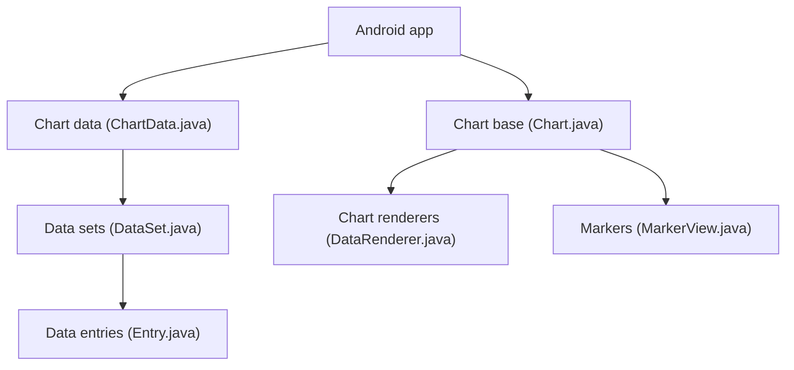

# PhilJay/MPAndroidChart

> Bibliothèque de graphiques pour Android, réécrite en Kotlin, avec module Jetpack Compose.

## Le problème
Dessiner des graphiques interactifs sur Android à la main est long : axes, zoom, sélection, animations.

## Ce que ça fait vraiment
Neuf types de graphiques (ligne, barres, camembert, nuage de points, chandeliers, bulles, radar, combiné). Zoom, glisser, mise en évidence, marqueurs, animations, formateurs. API par propriétés, fonctions composables en Compose, 35 chapitres de guides. Le README annonce 30 000 points fluides.

## Comment c'est branché


## Essayer
```kotlin
// settings.gradle.kts
dependencyResolutionManagement { repositories { maven("https://jitpack.io") } }
// build.gradle.kts
implementation("com.github.PhilJay.MPAndroidChart:MPChartLib:v4.0.1")
implementation("com.github.PhilJay.MPAndroidChart:MPChartCompose:v4.0.1") // Compose seulement
```

## Coût et pièges
Gratuit. minSdk 23, compileSdk 35, Java 17, Kotlin 2.0 ou plus. Le module Compose exige compileSdk 37. Fixer la version, ne pas suivre la dernière.

## Ce que ce n'est pas
Pas une bibliothèque de dataviz web ni Python : Android uniquement. La version iOS est un autre dépôt (Charts).

## Alternatives
- Charts : version iOS de la même bibliothèque.

## Pour toi
Sans intérêt pour un profil data/IA/MLOps hors développement mobile Android : à ignorer, sauf projet d'app Android précis.

