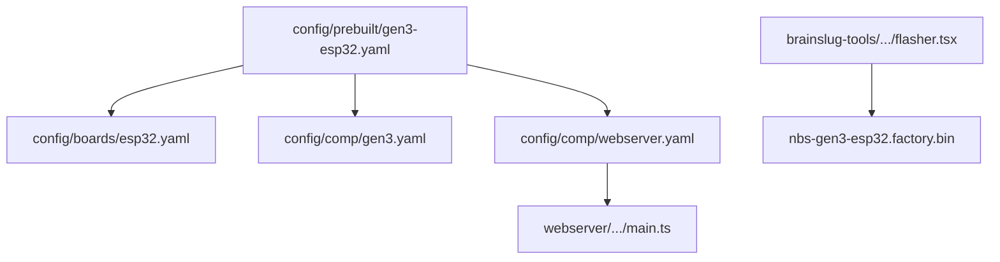

# Philip2809/neato-connected

> Gives local control back to Neato vacuums via an ESP32 running ESPHome, after the servers were shut down.

## The problem
After Neato's servers shut down, the robots lose their remote control.

## What it actually does
An ESP32 plugs into the robot's serial interface and exposes a local web interface, with a Home Assistant option. It starts and stops cleaning, reads status and errors and, depending on the generation (gen1 to gen3), sets parameters or schedules. Gen4 is not supported. Web tools let you flash the firmware.

## How it is wired
Diagram based on the code's diagram.

## Trying it
The README gives no command: you use the Vacuula Tools to identify the robot, then the ESPHome configuration files in the `config` folder.

## Cost and gotchas
Free, but you must buy an ESP32 board, wire it to the robot and have compatible firmware (gen2: 2.2.0 or 2.2.1; gen3: 4.5.3 or 4.6.0). Home Assistant is recommended.

## What it is not
Not an official Neato app. A project under development: the `main` branch only tracks releases.

## Alternatives
No alternative named in the README.

## For you
Ignore: home-automation hardware repair, unrelated to data / AI / MLOps work.
