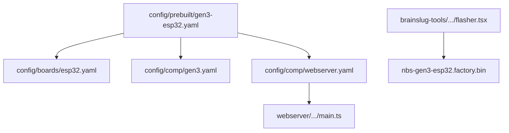

# Philip2809/neato-connected

> Redonne le contrôle local aux aspirateurs Neato via un ESP32 sous ESPHome, après l'arrêt des serveurs.

## Le problème
Après la fermeture des serveurs de Neato, les robots perdent leur commande à distance.

## Ce que ça fait vraiment
Un ESP32 se branche à l'interface série du robot et expose une interface web locale, avec option Home Assistant. Il démarre et arrête le nettoyage, lit l'état et les erreurs et, selon la génération (gen1 à gen3), règle les paramètres ou planifie. La gen4 n'est pas prise en charge. Des outils web permettent de flasher le firmware.

## Comment c'est branché
Schéma d'après le diagramme du code.

## Essayer
Le README ne donne pas de commande : on utilise les Vacuula Tools pour identifier le robot, puis les fichiers de configuration ESPHome du dossier `config`.

## Coût et pièges
Gratuit, mais il faut acheter une carte ESP32, la câbler au robot et avoir un firmware compatible (gen2 : 2.2.0 ou 2.2.1 ; gen3 : 4.5.3 ou 4.6.0). Home Assistant est conseillé.

## Ce que ce n'est pas
Pas une application officielle Neato. Projet en développement : la branche `main` ne suit que les versions.

## Alternatives
Aucune alternative nommée dans le README.

## Pour toi
À ignorer : réparation domotique de matériel, sans rapport avec un travail data / IA / MLOps.

