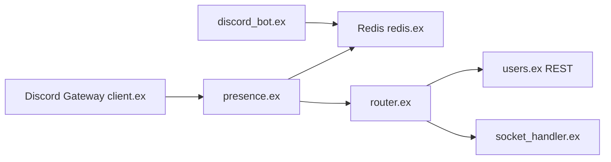

# Phineas/lanyard

> REST and WebSocket API that exposes a Discord user's live presence, for personal websites.

## The problem
Display on a site what you are listening to or doing on Discord without writing a bot.

## What it actually does
Receives events from the Discord Gateway, keeps per-user presence state, and serves it via `GET /v1/users/:id` and a WebSocket (opcodes Hello, Initialize, Heartbeat, Unsubscribe). A key-value (KV) store is added to the response, with limits (512 pairs, 30,000 characters). Redis is used for the KV and for node synchronization; Prometheus metrics. You must join Lanyard's Discord server to be tracked.

## How it is wired


## Trying it
```bash
docker build -t phineas/lanyard:latest .
docker run -d --name lanyard-redis -v docker_mount_location_on_host:/data redis
docker run --rm -it -p 4001:4001 -e REDIS_HOST=redis -e BOT_TOKEN=<token> --link lanyard-redis:redis phineas/lanyard:latest
```

## Cost and gotchas
Free. Self-hosting: Discord bot with presence and member intents, token, Redis, and HTTP only (reverse proxy for https). API key obtained by messaging the bot.

## What it is not
Not a guaranteed service: the public instance belongs to an individual.

## Alternatives
`use-lanyard`: React library recommended by the README for consuming the API.

## For you
Ignore: Discord profile gadget; the transferable part is a real-time presence feed over Redis and WebSocket.
