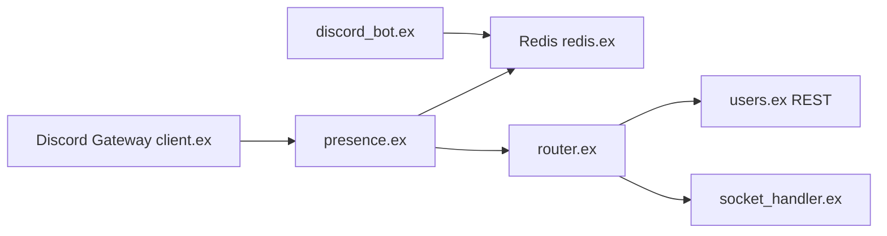

# Phineas/lanyard

> API REST et WebSocket qui expose en direct la présence Discord d'un utilisateur, pour sites personnels.

## Le problème
Afficher sur un site ce qu'on écoute ou fait sur Discord sans écrire un bot.

## Ce que ça fait vraiment
Reçoit les événements du Gateway Discord, garde l'état de présence par utilisateur, et le sert via `GET /v1/users/:id` et un WebSocket (opcodes Hello, Initialize, Heartbeat, Unsubscribe). Un magasin clé-valeur (KV) est ajouté à la réponse, avec limites (512 paires, 30 000 caractères). Redis sert au KV et à la synchro entre nœuds ; métriques Prometheus. Il faut rejoindre le serveur Discord de Lanyard pour être suivi.

## Comment c'est branché


## Essayer
```bash
docker build -t phineas/lanyard:latest .
docker run -d --name lanyard-redis -v docker_mount_location_on_host:/data redis
docker run --rm -it -p 4001:4001 -e REDIS_HOST=redis -e BOT_TOKEN=<token> --link lanyard-redis:redis phineas/lanyard:latest
```

## Coût et pièges
Gratuit. Auto-hébergement : bot Discord avec intents de présence et de membres, jeton, Redis, et HTTP seulement (reverse proxy pour https). Clé d'API obtenue par message au bot.

## Ce que ce n'est pas
Pas un service garanti : l'instance publique appartient à un particulier.

## Alternatives
`use-lanyard` : bibliothèque React recommandée par le README pour consommer l'API.

## Pour toi
À ignorer : gadget de profil Discord ; l'élément transposable est un flux de présence en temps réel sur Redis et WebSocket.

