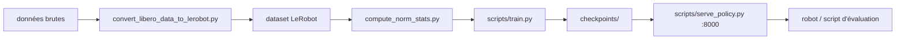

# Physical-Intelligence/openpi

> Open vision-language-action models for robotics, with pretrained checkpoints and fine-tuning.

## The problem
Training a robot policy from scratch requires thousands of hours of robot data
that almost nobody owns.

## What it actually does
Three models: π₀ (flow-matching VLA), π₀-FAST (autoregressive, FAST action tokenizer) and
π₀.₅ (better open-world generalization, trained with knowledge insulation). The base checkpoints
are pretrained on more than 10,000 hours of robot data; "expert" checkpoints
exist for DROID, ALOHA and LIBERO. The repo provides data conversion to the
LeRobot format, normalization statistics computation, JAX and PyTorch training, and a policy
server that can be queried over websocket.

## How it is wired


## Trying it
```bash
git clone --recurse-submodules git@github.com:Physical-Intelligence/openpi.git
GIT_LFS_SKIP_SMUDGE=1 uv sync
GIT_LFS_SKIP_SMUDGE=1 uv pip install -e .
uv run scripts/compute_norm_stats.py --config-name pi05_libero
XLA_PYTHON_CLIENT_MEM_FRACTION=0.9 uv run scripts/train.py pi05_libero --exp-name=my_experiment --overwrite
uv run scripts/serve_policy.py policy:checkpoint --policy.config=pi05_libero --policy.dir=checkpoints/pi05_libero/my_experiment/20000
```

## Cost and gotchas
NVIDIA GPU required: >8 GB for inference, >22.5 GB for LoRA, >70 GB (A100/H100) for full
fine-tuning. Ubuntu 22.04 only, no multi-node training. The PyTorch patch
copies files into `transformers` and, in uv's hardlink mode, durably contaminates the uv cache;
you need `uv cache clean transformers` to undo it. Checkpoints are downloaded from
`gs://openpi-assets`.

## What it is not
The authors say so: it is an experiment, π₀ was developed for their own robots and
may not work on yours. The expert checkpoints come from restricted datasets and
do not necessarily generalize to your setup. Mixed precision is not yet supported on the
PyTorch side.

## Alternatives
No competing project named; LeRobot is used as a data format, not as an alternative.

## For you
Out of scope unless you have a robotics project; the cross-cutting interest is the "policy server +
client" pattern, transferable to any heavy remote inference.
