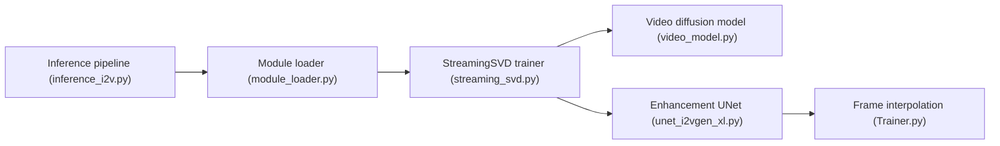

# Picsart-AI-Research/StreamingT2V

> Research code that generates long, coherent videos from an image by extending SVD autoregressively.

## The problem
Common video models produce short clips; making a video longer while keeping coherence and motion is hard.

## What it actually does
- StreamingSVD: autoregressive image-to-video generation, up to 200 frames, followed by enhancement and frame interpolation.
- Optional randomized blending between chunks.
- Provides the MAWE metric and points to StreamingModelscope.
- Accepted at CVPR 2025 according to the README; weights on Hugging Face.

## How it is wired


## Trying it
```bash
git clone https://github.com/Picsart-AI-Research/StreamingT2V.git
cd StreamingT2V/
virtualenv -p python3.9 venv
source venv/bin/activate
pip install -r requirements.txt
cd code
python inference_i2v.py --input $INPUT --output $OUTPUT
```

## Cost and gotchas
60 GB of VRAM by default for 200 frames; 24 GB with `--use_memopt`, about 50% slower. CUDA 11.8 minimum, Python 3.9, FFmpeg. No declared license; last push March 2025. The text-to-video version of StreamingSVD is listed in future plans.

## What it is not
Not a service nor a production-ready model; with no license, reuse is uncertain.

## Alternatives
The README cites SVD and I2VGen-XL as bases or neighboring methods.

## For you
Worth watching: a research reference for long video, but very demanding hardware and a murky legal status.
