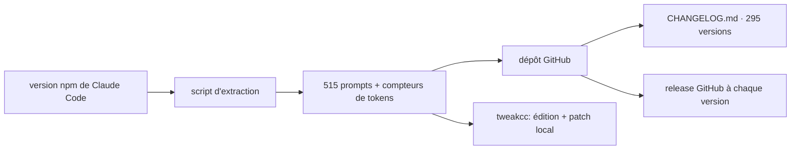

# Piebald-AI/claude-code-system-prompts

> Up-to-date catalog of Claude Code's system prompts, with token counts and changelog.

## The problem
Claude Code does not have a single system prompt but hundreds of conditional strings buried
in a large minified JS file — impossible to read by hand.

## What it actually does
The repository lists 515 prompts extracted by script from the npm version of Claude Code, with their
token count, up to date with v2.1.278. It also provides a CHANGELOG.md covering 295 versions
since v2.0.14, updated within minutes of each release. The prompts are classified:
sub-agents (Explore, Plan), creation assistants (CLAUDE.md, statusline), slash commands
(`/code-review` in ten parts, `/security-review`, `/schedule`, `/simplify`), utilities (conversation
summary, agent state classifier, security monitor, title generation) and embedded
reference data.

## How it is wired

## Trying it
No command is documented: the repository is meant to be read, not installed. To modify the prompts
of your own installation, the README points to the third-party tool tweakcc, which edits the prompts
as markdown files then patches the npm or binary installation, with conflict handling.

## Cost and gotchas
Free. The content is extracted from the compiled code, so it matches what Claude Code uses, but
some prompts contain interpolated parts — the actual in-session counts differ,
probably by less than ±20 tokens. The repository also serves as a showcase for the commercial Piebald product.

## What it is not
It is not official Anthropic documentation, nor a tool: it is an extraction kept
up to date by a third party. Nor is it a way to modify Claude Code — that goes through tweakcc,
a separate project.

## Alternatives
The README cites tweakcc for editing and patching prompts locally; no competing catalog
is named.

## For you
A goldmine if you write your own agent prompts: reading how `/code-review`, the security
monitor or the state classifier are worded is worth several blog posts.
