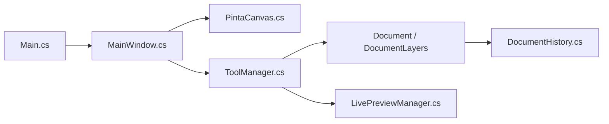

# PintaProject/Pinta

> Simple raster image editor, a GTK clone of Paint.NET, for Linux, Windows and macOS.

## The problem
Editing images simply, on Linux or macOS, without an equivalent of Paint.NET.

## What it actually does
Layered editor with undo/redo history, selection, and tools and effects loaded as extensions, with an asynchronous live preview. A .NET 10 application with GTK4/libadwaita. Formats go through GdkPixbuf and a dedicated ORA format. External extensions are installed through an add-ons service.

## How it is wired


## Trying it
```bash
dotnet build
dotnet run --project Pinta
```

## Cost and gotchas
Free. .NET 10 SDK required; Linux: gtk ≥ 4.18 and libadwaita ≥ 1.8. On macOS, set `DYLD_LIBRARY_PATH`. Windows signing via SignPath.

## What it is not
Not a Photoshop equivalent: it is a deliberately simple clone of Paint.NET 3.0. The Silk and Fugue icons are under CC-BY 3.0, not MIT.

## Alternatives
No alternative named in the README.

## For you
Ignore: a desktop image editor with no link to data/AI; at most useful for touching up screenshots.
