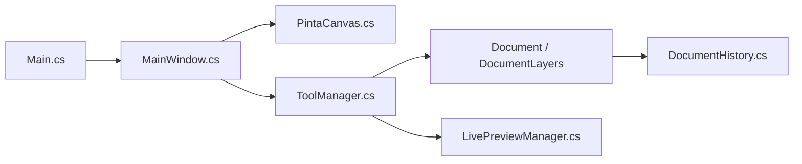

# PintaProject/Pinta

> Éditeur d'images raster simple, clone GTK de Paint.NET, pour Linux, Windows et macOS.

## Le problème
Retoucher des images simplement, sous Linux ou macOS, sans l'équivalent de Paint.NET.

## Ce que ça fait vraiment
Éditeur à calques avec historique annuler/rétablir, sélection, outils et effets chargés comme extensions, aperçu en direct asynchrone. Application .NET 10 avec GTK4/libadwaita. Les formats passent par GdkPixbuf et un format ORA propre. Des extensions externes s'installent via un service d'add-ons.

## Comment c'est branché


## Essayer
```bash
dotnet build
dotnet run --project Pinta
```

## Coût et pièges
Gratuit. SDK .NET 10 requis ; Linux : gtk ≥ 4.18 et libadwaita ≥ 1.8. Sur macOS, définir `DYLD_LIBRARY_PATH`. Signature Windows via SignPath.

## Ce que ce n'est pas
Pas un équivalent de Photoshop : c'est un clone volontairement simple de Paint.NET 3.0. Les icônes Silk et Fugue sont sous CC-BY 3.0, pas MIT.

## Alternatives
Aucune alternative nommée dans le README.

## Pour toi
Ignorer : éditeur d'images de bureau sans lien avec data/IA ; sert tout au plus à retoucher des captures.

